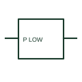

# ANSI/IEEE Minimum active-power relay form

IEEE-library form of minimum active-power relay: a minimum active-power relay operates according to a configured low active-power condition.

[Canonical reference](https://eloragrid.ai/symbols/ansi-minimum-active-power-relay) · [Structured record](../entries/ansi-minimum-active-power-relay.json) · [All references](README.md)

Updated: 2026-10-28. Drawing use: SLD, Schematic. Reference families: IEEE / ANSI, Manufacturer.

Graphical convention: IEEE / ANSI. Minimum Active Power Relay.

## What it represents

This reference locates minimum active-power relay in Autodesk's IEEE-oriented miscellaneous relays family. A minimum active-power relay operates according to a configured low active-power condition. The measurement direction and enable logic determine what low power means in the control sequence. The public library uses HCR1F43 for its horizontal representation; this is a vendor block name, not an IEEE standards symbol number.
Trace the measured quantity or initiating control signal separately from the output contacts. The device tag links the sensing or operating element to the controlled circuit; settings, reset behaviour and the actual terminal arrangement belong in the selected equipment documentation.
Identify the directional convention before evaluating the threshold. Minimum active power and reverse power are different operating criteria. The linked functional counterpart explains the same operating role in its own drawing context; agreement of every detailed convention mark is not asserted.

## How to read it

- Identify the directional convention before evaluating the threshold.
- The preview is an original explanation of this function. Match the actual drawing convention to its legend and the selected equipment documentation.

## Drawing checklist

- Show voltage/current inputs
- State power direction
- Reference threshold and enabling logic

## Important distinction

Minimum active power and reverse power are different operating criteria.

## Facts

- Convention evidence: Autodesk IEEE Symbol Preview: Miscellaneous Relays; published form: Minimum Active Power Relay.
- Public vendor block: HCR1F43. Vendor library token, not an IEEE symbol number.
- Drawing role: Monitoring element
- Identifier status: The short label is a functional lookup label, not an assigned IEC or IEEE symbol number. Any separately listed Autodesk code is a verified vendor block name.
- Artwork scope: Original educational geometry. Exact standard graphics, product ratings and terminal pinouts are not certified.

## Public references

- [Autodesk IEEE Symbol Preview: Miscellaneous Relays](https://help.autodesk.com/cloudhelp/2021/ENU/AutoCAD-Electrical/files/GUID-DA549E3E-4ABB-426E-9331-0226EF55EAA7.htm) — Autodesk. Public IEEE-oriented Miscellaneous Relays table explicitly lists HCR1F43 as Minimum Active Power Relay. This supports the vendor convention context, not reproduction of the publisher graphic.

## Related references

- [Minimum active-power relay](minimum-active-power-relay.md)
- [Current transformer](current-transformer.md)
- [Relay coil](relay-coil.md)

Original educational concept geometry, CC BY 4.0. Unitless; not a certified standards glyph or manufacturer footprint.

Elora-authored explanations are CC BY 4.0. Linked standards and manufacturer material retain their own rights. Confirm project requirements using primary sources.
