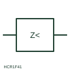

# ANSI/IEEE Minimum-impedance measuring relay form

IEEE-library form of minimum-impedance measuring relay: measuring relay that compares voltage with current and operates when the apparent impedance falls below a set value.

[Canonical reference](https://eloragrid.ai/symbols/ansi-minimum-impedance-relay) · [Structured record](../entries/ansi-minimum-impedance-relay.json) · [All references](README.md)

Updated: 2026-10-28. Drawing use: Schematic, SLD. Reference families: IEEE / ANSI, Manufacturer.

Graphical convention: IEEE / ANSI. Minimum Impedance Relay.

## What it represents

This reference locates minimum-impedance measuring relay in Autodesk's IEEE-oriented miscellaneous relays family. A minimum-impedance relay divides measured voltage by measured current and operates when the result falls below its setting, indicating a fault close enough to fall inside its reach. It is used as generator and transformer backup protection and is the basic idea behind distance protection. The public library uses HCR1F41 for its horizontal representation; this is a vendor block name, not an IEEE standards symbol number.
Trace the measured quantity or initiating control signal separately from the output contacts. The device tag links the sensing or operating element to the controlled circuit; settings, reset behaviour and the actual terminal arrangement belong in the selected equipment documentation.
The relay needs both CT and VT inputs, so the symbol should always be read with both connections. It does not show the characteristic shape on the impedance plane, any directional element, or the loss-of-voltage blocking needed to avoid operation when the VT supply fails. Confirm both voltage and current inputs are shown. A minimum-impedance relay uses voltage and current together; an overcurrent relay uses current alone. The linked functional counterpart explains the same operating role in its own drawing context; agreement of every detailed convention mark is not asserted.

## How to read it

- Confirm both voltage and current inputs are shown.
- Check for VT fuse-failure blocking.

## Drawing checklist

- Show CT and VT inputs
- State reach and delay
- Reference blocking logic

## Important distinction

A minimum-impedance relay uses voltage and current together; an overcurrent relay uses current alone.

## Facts

- Convention evidence: Autodesk IEEE Symbol Preview: Miscellaneous Relays; published form: Minimum Impedance Relay.
- Public vendor block: HCR1F41. Vendor library token, not an IEEE symbol number.
- Measured quantity: Apparent impedance from voltage and current
- Preview: Independent educational concept; consult the publisher and applicable standard for the exact graphic
- Artwork scope: Original educational geometry. Exact standard graphics, product ratings and terminal pinouts are not certified.

## Public references

- [Autodesk IEEE Symbol Preview: Miscellaneous Relays](https://help.autodesk.com/cloudhelp/2021/ENU/AutoCAD-Electrical/files/GUID-DA549E3E-4ABB-426E-9331-0226EF55EAA7.htm) — Autodesk. Public IEEE-oriented Miscellaneous Relays table explicitly lists HCR1F41 as Minimum Impedance Relay. This supports the vendor convention context, not reproduction of the publisher graphic.
- [IEC graphical symbols for diagrams](https://tc3.iec.ch/tc-activity/graphical-symbols-for-diagrams/) — IEC. IEC context for graphical symbols used in diagrams; no IEC graphic is reproduced.

## Related references

- [Minimum-impedance measuring relay](minimum-impedance-relay.md)
- [Distance protection](21-distance-protection.md)
- [Voltage transformer](voltage-transformer.md)
- [Current transformer](current-transformer.md)

Original educational concept geometry, CC BY 4.0. Unitless; not a certified standards glyph or manufacturer footprint.

Elora-authored explanations are CC BY 4.0. Linked standards and manufacturer material retain their own rights. Confirm project requirements using primary sources.
