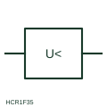

# ANSI/IEEE Minimum-voltage measuring relay form

IEEE-library form of minimum-voltage measuring relay: measuring relay that operates when voltage falls below a set level while some voltage is still present.

[Canonical reference](https://eloragrid.ai/symbols/ansi-minimum-voltage-relay) · [Structured record](../entries/ansi-minimum-voltage-relay.json) · [All references](README.md)

Updated: 2026-10-28. Drawing use: Schematic, SLD. Reference families: IEEE / ANSI, Manufacturer.

Graphical convention: IEEE / ANSI. Minimum Voltage Protection.

## What it represents

This reference locates minimum-voltage measuring relay in Autodesk's IEEE-oriented voltage protection relays family. The minimum-voltage relay form operates when the measured voltage falls below its setting. It is used for motor undervoltage tripping, load shedding and transfer schemes, where a sustained voltage dip indicates a supply problem rather than a momentary disturbance. The public library uses HCR1F35 for its horizontal representation; this is a vendor block name, not an IEEE standards symbol number.
Trace the measured quantity or initiating control signal separately from the output contacts. The device tag links the sensing or operating element to the controlled circuit; settings, reset behaviour and the actual terminal arrangement belong in the selected equipment documentation.
The symbol shows the voltage quantity and the less-than threshold but not the time delay, which phases are monitored or whether operation is blocked on VT fuse failure. Without a blocking input a blown VT fuse can cause an unwanted trip, so the supervision arrangement should be cross-referenced. Check which phase voltages are monitored. A minimum-voltage relay responds to a reduced voltage; a loss-of-voltage relay responds to absence of voltage. The linked functional counterpart explains the same operating role in its own drawing context; agreement of every detailed convention mark is not asserted.

## How to read it

- Check which phase voltages are monitored.
- Look for VT supervision or fuse-failure blocking.

## Drawing checklist

- State threshold and delay
- Show VT source
- Reference blocking input

## Important distinction

A minimum-voltage relay responds to a reduced voltage; a loss-of-voltage relay responds to absence of voltage.

## Facts

- Convention evidence: Autodesk IEEE Symbol Preview: Voltage Protection Relays; published form: Minimum Voltage Protection.
- Public vendor block: HCR1F35. Vendor library token, not an IEEE symbol number.
- Measured quantity: Voltage below a set level
- Preview: Independent educational concept; consult the publisher and applicable standard for the exact graphic
- Artwork scope: Original educational geometry. Exact standard graphics, product ratings and terminal pinouts are not certified.

## Public references

- [Autodesk IEEE Symbol Preview: Voltage Protection Relays](https://help.autodesk.com/cloudhelp/2021/ENU/AutoCAD-Electrical/files/GUID-5D942536-ADE3-43EA-8280-CC7907C38F15.htm) — Autodesk. Public IEEE-oriented Voltage Protection Relays table explicitly lists HCR1F35 as Minimum Voltage Protection. This supports the vendor convention context, not reproduction of the publisher graphic.
- [IEC graphical symbols for diagrams](https://tc3.iec.ch/tc-activity/graphical-symbols-for-diagrams/) — IEC. IEC context for graphical symbols used in diagrams; no IEC graphic is reproduced.

## Related references

- [Minimum-voltage measuring relay](minimum-voltage-relay.md)
- [Loss-of-voltage monitoring relay](loss-of-voltage-monitoring-relay.md)
- [Undervoltage](27-undervoltage.md)
- [Voltage transformer](voltage-transformer.md)

Original educational concept geometry, CC BY 4.0. Unitless; not a certified standards glyph or manufacturer footprint.

Elora-authored explanations are CC BY 4.0. Linked standards and manufacturer material retain their own rights. Confirm project requirements using primary sources.
