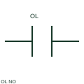

# ANSI/IEEE motor overload alarm no contact symbol

IEEE-oriented graphical reference for motor overload alarm no contact, with public vendor evidence and drawing-reading notes.

[Canonical reference](https://eloragrid.ai/symbols/ansi-motor-overload-alarm-no-contact) · [Structured record](../entries/ansi-motor-overload-alarm-no-contact.json) · [All references](README.md)

Updated: 2026-10-27. Drawing use: Schematic. Reference families: IEEE / ANSI, Manufacturer.

Graphical convention: IEEE / ANSI. Autodesk IEEE-oriented Motor Control functional form.

## What it represents

The overload NO contact form identifies a signal path associated with overload-device operation. Its destination may be a lamp, controller or alarm circuit and is separate from the contact used to interrupt the motor command.
This is a convention-specific lookup based on the publisher's IEEE-labelled preview. The geometry here is independently drawn to explain the connection or operation; it is not a certified reproduction of the standard graphic.

## How to read it

- Verify the alarm contact state after reset.
- Read the selected library and the project legend together. A vendor block identifier is meaningful within its named library and is not a universal standard-symbol code.

## Drawing checklist

- Link overload tag
- Show alarm destination
- Reference contact sequence

## Important distinction

Overload alarm status and contactor closed-position status describe different equipment conditions.

## Facts

- Convention evidence: Autodesk IEEE Symbol Preview — Motor Control
- Public vendor block name: HOL21 (Autodesk identifier; not an IEEE symbol number)
- Standards context: IEEE/ANSI 315-1975 covers diagram graphics. IEEE lists this edition as Inactive-Reserved.
- Artwork scope: Original functional illustration; exact standard glyph and compliance are not certified

## Public references

- [Autodesk IEEE Symbol Preview — Motor Control](https://help.autodesk.com/cloudhelp/2021/ENU/AutoCAD-Electrical/files/GUID-3B645A95-BC10-4FA4-8BBF-9A5FFF6BE802.htm) — Autodesk. Exact public IEEE-oriented category page verifying the component name and vendor block identifier.
- [IEEE/ANSI 315-1975: graphic symbols for electrical and electronics diagrams](https://standards.ieee.org/ieee/315/515/) — IEEE Standards Association. Graphic-symbol standards context and official status; not a source of reproduced artwork.

## Related references

- [Motor overload alarm NO contact](motor-overload-alarm-no-contact.md)
- [Normally open contact](normally-open-contact.md)
- [Normally closed contact](normally-closed-contact.md)

Original educational concept geometry, CC BY 4.0. Unitless; not a certified standards glyph or manufacturer footprint.

Elora-authored explanations are CC BY 4.0. Linked standards and manufacturer material retain their own rights. Confirm project requirements using primary sources.
