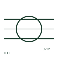

# ANSI/IEEE multi-conductor cable symbol

IEEE-oriented outline or bracket grouping several conductors to show they belong to one multi-conductor cable.

[Canonical reference](https://eloragrid.ai/symbols/ansi-multi-conductor-cable) · [Structured record](../entries/ansi-multi-conductor-cable.json) · [All references](README.md)

Updated: 2026-10-28. Drawing use: Schematic. Reference families: IEEE / ANSI.

Graphical convention: IEEE / ANSI. Multi-conductor cable grouping.

## What it represents

US-practice schematics group conductors of one cable with an enclosing outline, a bracket or an oval drawn across the conductor lines, usually with the cable number beside it. It lets the reader see which wires travel together between enclosures.
This illustration explains the convention rather than reproducing the IEEE graphic. The grouping implies no shield. Cable conductor count, gauge and insulation rating come from the cable schedule, and spare conductors are often not drawn.

## How to read it

- Read the cable number next to the grouping.
- Expect undrawn spare conductors.

## Drawing checklist

- Tag every grouping with the cable number.
- Use the same tag across sheets.
- Record gauge and spares in the schedule.

## Important distinction

A cable grouping shows shared jacket only; a shielded cable form adds a conductive shield.

## Facts

- Convention evidence: IEEE 315 graphic conventions for multiple-conductor cable (standards context only)
- Standards context: IEEE/ANSI 315-1975 covers diagram graphics; IEEE lists this edition as Inactive-Reserved.
- Preview: Original educational illustration; consult the publisher and applicable standard for the exact graphic

## Public references

- [IEEE/ANSI 315-1975: graphic symbols for electrical and electronics diagrams](https://standards.ieee.org/ieee/315/515/) — IEEE Standards Association. Graphic-symbol standards context and official status; not a source of reproduced artwork.
- [Autodesk IEC-60617 preview: Cable identification and twisted-pair annotation](https://help.autodesk.com/cloudhelp/2021/ENU/AutoCAD-Electrical/files/GUID-37A08C35-43A3-484D-B0EB-0BBCBC4BE709.htm) — Autodesk. Public publisher family for cable markers in the companion IEC library.

## Related references

- [Conductors within one cable](iec-multicore-cable-grouping.md)
- [Cable identification marker](iec-cable-identification-marker.md)
- [ANSI/IEEE shielded conductor symbol](ansi-shielded-conductor.md)

Original educational concept geometry, CC BY 4.0. Unitless; not a certified standards glyph or manufacturer footprint.

Elora-authored explanations are CC BY 4.0. Linked standards and manufacturer material retain their own rights. Confirm project requirements using primary sources.
