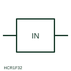

# ANSI/IEEE Neutral-current measuring relay form

IEEE-library form of neutral-current measuring relay: measuring relay fed from a CT in a neutral conductor or star-point connection, responding to neutral current.

[Canonical reference](https://eloragrid.ai/symbols/ansi-neutral-current-relay) · [Structured record](../entries/ansi-neutral-current-relay.json) · [All references](README.md)

Updated: 2026-10-28. Drawing use: Schematic, SLD. Reference families: IEEE / ANSI, Manufacturer.

Graphical convention: IEEE / ANSI. In Neutral.

## What it represents

This reference locates neutral-current measuring relay in Autodesk's IEEE-oriented current protection relays family. This relay form is used where a CT is installed in a neutral conductor or in the earthing connection of a transformer or generator star point. Current there indicates earth faults or, in four-wire systems, heavy unbalance and triplen harmonic loading, depending on where the CT sits. The public library uses HCR1F32 for its horizontal representation; this is a vendor block name, not an IEEE standards symbol number.
Trace the measured quantity or initiating control signal separately from the output contacts. The device tag links the sensing or operating element to the controlled circuit; settings, reset behaviour and the actual terminal arrangement belong in the selected equipment documentation.
The symbol identifies the measured conductor but not the purpose. A neutral CT in the star-point earth lead gives standby earth-fault protection, while one in the four-wire neutral of a feeder sees load unbalance as well, so settings and grading differ greatly. Confirm whether the CT is in the neutral conductor or the earthing lead. A neutral-current relay measures one neutral path; a residual connection sums the three phase CTs to derive the same quantity. The linked functional counterpart explains the same operating role in its own drawing context; agreement of every detailed convention mark is not asserted.

## How to read it

- Confirm whether the CT is in the neutral conductor or the earthing lead.
- Check grading against downstream earth-fault devices.

## Drawing checklist

- Show neutral CT location
- State setting and delay
- Reference grading study

## Important distinction

A neutral-current relay measures one neutral path; a residual connection sums the three phase CTs to derive the same quantity.

## Facts

- Convention evidence: Autodesk IEEE Symbol Preview: Current Protection Relays; published form: In Neutral.
- Public vendor block: HCR1F32. Vendor library token, not an IEEE symbol number.
- Measured quantity: Current in a neutral or star-point conductor
- Preview: Independent educational concept; consult the publisher and applicable standard for the exact graphic
- Artwork scope: Original educational geometry. Exact standard graphics, product ratings and terminal pinouts are not certified.

## Public references

- [Autodesk IEEE Symbol Preview: Current Protection Relays](https://help.autodesk.com/cloudhelp/2021/ENU/AutoCAD-Electrical/files/GUID-EC11EC4D-374C-4191-9534-C802D3932711.htm) — Autodesk. Public IEEE-oriented Current Protection Relays table explicitly lists HCR1F32 as In Neutral. This supports the vendor convention context, not reproduction of the publisher graphic.
- [IEC graphical symbols for diagrams](https://tc3.iec.ch/tc-activity/graphical-symbols-for-diagrams/) — IEC. IEC context for graphical symbols used in diagrams; no IEC graphic is reproduced.

## Related references

- [Neutral-current measuring relay](neutral-current-relay.md)
- [Residual connection of phase CTs](residual-connection-of-phase-cts.md)
- [Earth-fault current relay](earth-fault-current-relay.md)
- [Time overcurrent](51-time-overcurrent.md)

Original educational concept geometry, CC BY 4.0. Unitless; not a certified standards glyph or manufacturer footprint.

Elora-authored explanations are CC BY 4.0. Linked standards and manufacturer material retain their own rights. Confirm project requirements using primary sources.
