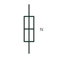

# ANSI/IEEE Neutral link, closed form

IEEE-library form of neutral link, closed: a removable link in the neutral conductor shown in its closed position, allowing the neutral to be opened for testing.

[Canonical reference](https://eloragrid.ai/symbols/ansi-neutral-link-closed) · [Structured record](../entries/ansi-neutral-link-closed.json) · [All references](README.md)

Updated: 2026-10-28. Drawing use: SLD, Schematic. Reference families: IEEE / ANSI, Manufacturer.

Graphical convention: IEEE / ANSI. Neutral Link - Closed.

## What it represents

This reference locates neutral link, closed in Autodesk's IEEE-oriented fuses family. A neutral link is a bolted or plug-in link in the neutral conductor, often mounted in a fuse carrier style holder alongside phase fuses. It allows the neutral of a circuit to be disconnected for insulation testing or fault finding without disturbing other circuits on the neutral bar. The closed form shows its normal service state. The public library uses HFU1NLC for its horizontal representation; this is a vendor block name, not an IEEE standards symbol number.
Use the surrounding circuit labels and the project legend to identify the intended operating condition and connection. Carry the same device reference into the schedule or equipment document so the symbol can be reconciled with its real terminals, function and operating limits.
The symbol is not a switch and the link should not be opened under load. It does not provide overcurrent protection; the fuse-like holder can mislead readers into treating it as a neutral fuse. Rules on whether the neutral may be separately disconnected differ between earthing schemes. Do not read the holder as a fuse. A closed neutral link is a removable connection; a neutral fuse would be a protective device and is generally not permitted. The linked functional counterpart explains the same operating role in its own drawing context; agreement of every detailed convention mark is not asserted.

## How to read it

- Do not read the holder as a fuse.
- Confirm the link is opened only with the circuit isolated.

## Drawing checklist

- Label the link with its circuit number.
- Show it in its normal closed state.
- Check scheme rules for neutral disconnection.

## Important distinction

A closed neutral link is a removable connection; a neutral fuse would be a protective device and is generally not permitted.

## Facts

- Convention evidence: Autodesk IEEE Symbol Preview: Fuses; published form: Neutral Link - Closed.
- Public vendor block: HFU1NLC. Vendor library token, not an IEEE symbol number.
- Graphic cue: Fuse-carrier style link drawn bridged
- Publisher form: Neutral Link - Closed (HFU1NLC Autodesk identifier)
- Preview: Original educational illustration; consult the publisher and applicable standard for the exact graphic
- Artwork scope: Original educational geometry. Exact standard graphics, product ratings and terminal pinouts are not certified.

## Public references

- [Autodesk IEEE Symbol Preview — Fuses](https://help.autodesk.com/cloudhelp/2021/ENU/AutoCAD-Electrical/files/GUID-5CF1E8F7-6883-4C9B-9BB3-6CD1A9339AE5.htm) — Autodesk. Public IEEE-oriented Fuses table explicitly lists HFU1NLC as Neutral Link - Closed. This supports the vendor convention context, not reproduction of the publisher graphic.
- [Definition of standardised earthing schemes](https://www.electrical-installation.org/enwiki/Definition_of_standardised_earthing_schemes) — Schneider Electric, Electrical Installation Guide. Public installation-guide definitions of the neutral's role in earthing schemes.

## Related references

- [Neutral link, closed](iec-neutral-link-closed.md)
- [Neutral link, open](iec-neutral-link-open.md)
- [Neutral conductor mark](iec-neutral-conductor-mark.md)
- [Fuse](fuse.md)

Original educational concept geometry, CC BY 4.0. Unitless; not a certified standards glyph or manufacturer footprint.

Elora-authored explanations are CC BY 4.0. Linked standards and manufacturer material retain their own rights. Confirm project requirements using primary sources.
