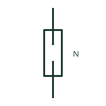

# ANSI/IEEE Neutral link, open form

IEEE-library form of neutral link, open: a neutral link drawn removed or open, showing the neutral conductor disconnected at that point.

[Canonical reference](https://eloragrid.ai/symbols/ansi-neutral-link-open) · [Structured record](../entries/ansi-neutral-link-open.json) · [All references](README.md)

Updated: 2026-10-28. Drawing use: SLD, Schematic. Reference families: IEEE / ANSI, Manufacturer.

Graphical convention: IEEE / ANSI. Neutral Link - Open.

## What it represents

This reference locates neutral link, open in Autodesk's IEEE-oriented fuses family. The open neutral link shows the link withdrawn so that the neutral is disconnected. Drawings use it where a circuit is normally run with the neutral open, for example to isolate a spare or to segregate a neutral during a changeover, and on test procedures that show the link removed. The public library uses HFU1NLO for its horizontal representation; this is a vendor block name, not an IEEE standards symbol number.
Use the surrounding circuit labels and the project legend to identify the intended operating condition and connection. Carry the same device reference into the schedule or equipment document so the symbol can be reconciled with its real terminals, function and operating limits.
An open neutral on a live four-wire circuit can cause severe overvoltage on single-phase loads, so an open link in normal service needs a clear reason on the drawing. The symbol says nothing about the phase conductors, which may still be energised. Ask why the neutral is shown open in service. An open neutral link is disconnected; the closed form shows normal continuity. The linked functional counterpart explains the same operating role in its own drawing context; agreement of every detailed convention mark is not asserted.

## How to read it

- Ask why the neutral is shown open in service.
- Check that phases are also isolated before working.

## Drawing checklist

- Note the reason the link is open.
- Show phase isolation state alongside.
- Label the link with its circuit number.

## Important distinction

An open neutral link is disconnected; the closed form shows normal continuity.

## Facts

- Convention evidence: Autodesk IEEE Symbol Preview: Fuses; published form: Neutral Link - Open.
- Public vendor block: HFU1NLO. Vendor library token, not an IEEE symbol number.
- Graphic cue: Fuse-carrier style link with the bridge missing
- Publisher form: Neutral Link - Open (HFU1NLO Autodesk identifier)
- Preview: Original educational illustration; consult the publisher and applicable standard for the exact graphic
- Artwork scope: Original educational geometry. Exact standard graphics, product ratings and terminal pinouts are not certified.

## Public references

- [Autodesk IEEE Symbol Preview — Fuses](https://help.autodesk.com/cloudhelp/2021/ENU/AutoCAD-Electrical/files/GUID-5CF1E8F7-6883-4C9B-9BB3-6CD1A9339AE5.htm) — Autodesk. Public IEEE-oriented Fuses table explicitly lists HFU1NLO as Neutral Link - Open. This supports the vendor convention context, not reproduction of the publisher graphic.
- [Definition of standardised earthing schemes](https://www.electrical-installation.org/enwiki/Definition_of_standardised_earthing_schemes) — Schneider Electric, Electrical Installation Guide. Public installation-guide definitions of the neutral's role in earthing schemes.

## Related references

- [Neutral link, open](iec-neutral-link-open.md)
- [Neutral link, closed](iec-neutral-link-closed.md)
- [Neutral conductor mark](iec-neutral-conductor-mark.md)
- [Disconnect terminal block](disconnect-terminal-block.md)

Original educational concept geometry, CC BY 4.0. Unitless; not a certified standards glyph or manufacturer footprint.

Elora-authored explanations are CC BY 4.0. Linked standards and manufacturer material retain their own rights. Confirm project requirements using primary sources.
