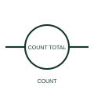

# ANSI/IEEE Non-resettable counter relay form

IEEE-library form of non-resettable counter relay: a non-resettable counter records events without a normal user reset function.

[Canonical reference](https://eloragrid.ai/symbols/ansi-non-resettable-counter-relay) · [Structured record](../entries/ansi-non-resettable-counter-relay.json) · [All references](README.md)

Updated: 2026-10-28. Drawing use: Schematic. Reference families: IEEE / ANSI, Manufacturer.

Graphical convention: IEEE / ANSI. Counter No Reset.

## What it represents

This reference locates non-resettable counter relay in Autodesk's IEEE-oriented counter relays family. A non-resettable counter records events without a normal user reset function. It is used where the total event history is part of the documented equipment indication. The public library uses HCR1CNN for its horizontal representation; this is a vendor block name, not an IEEE standards symbol number.
Trace the measured quantity or initiating control signal separately from the output contacts. The device tag links the sensing or operating element to the controlled circuit; settings, reset behaviour and the actual terminal arrangement belong in the selected equipment documentation.
Check the specified retention behaviour when the auxiliary supply is lost. A totalising counter is different from a preset counter intended to be reset each operating cycle. The linked functional counterpart explains the same operating role in its own drawing context; agreement of every detailed convention mark is not asserted.

## How to read it

- Check the specified retention behaviour when the auxiliary supply is lost.
- The preview is an original explanation of this function. Match the actual drawing convention to its legend and the selected equipment documentation.

## Drawing checklist

- Define qualifying event
- State counter supply
- Reference retention and rollover

## Important distinction

A totalising counter is different from a preset counter intended to be reset each operating cycle.

## Facts

- Convention evidence: Autodesk IEEE Symbol Preview: Counter Relays; published form: Counter No Reset.
- Public vendor block: HCR1CNN. Vendor library token, not an IEEE symbol number.
- Drawing role: Relay operation
- Identifier status: The short label is a functional lookup label, not an assigned IEC or IEEE symbol number. Any separately listed Autodesk code is a verified vendor block name.
- Artwork scope: Original educational geometry. Exact standard graphics, product ratings and terminal pinouts are not certified.

## Public references

- [Autodesk IEEE Symbol Preview: Counter Relays](https://help.autodesk.com/cloudhelp/2021/ENU/AutoCAD-Electrical/files/GUID-6A79079B-1B7A-45B5-9B28-CA7893CFF46F.htm) — Autodesk. Public IEEE-oriented Counter Relays table explicitly lists HCR1CNN as Counter No Reset. This supports the vendor convention context, not reproduction of the publisher graphic.

## Related references

- [Non-resettable counter relay](non-resettable-counter-relay.md)
- [Relay coil](relay-coil.md)
- [Normally open contact](normally-open-contact.md)

Original educational concept geometry, CC BY 4.0. Unitless; not a certified standards glyph or manufacturer footprint.

Elora-authored explanations are CC BY 4.0. Linked standards and manufacturer material retain their own rights. Confirm project requirements using primary sources.
