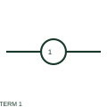

# ANSI/IEEE numbered terminal symbol

IEEE-oriented numbered connection-point form, with public vendor evidence and terminal-reading notes.

[Canonical reference](https://eloragrid.ai/symbols/ansi-numbered-terminal) · [Structured record](../entries/ansi-numbered-terminal.json) · [All references](README.md)

Updated: 2026-10-27. Drawing use: Schematic. Reference families: IEEE / ANSI, Manufacturer.

Graphical convention: IEEE / ANSI. Autodesk IEEE round terminal with terminal number.

## What it represents

A numbered terminal form provides an identifiable wiring interface whose connection path is followed through the terminal plan. The number distinguishes the connection point; it does not describe every physical feature of the terminal body.
This is a convention-specific lookup based on the publisher's IEEE-labelled preview. The geometry here is independently drawn to explain the connection or operation; it is not a certified reproduction of the standard graphic.

## How to read it

- Match the terminal number to both conductor destinations.
- Read the selected library and the project legend together. A vendor block identifier is meaningful within its named library and is not a universal standard-symbol code.

## Drawing checklist

- Identify terminal strip/position
- Show connection continuity
- Reference conductor schedule

## Important distinction

A numbered schematic terminal is not a dimensional terminal-block footprint.

## Facts

- Convention evidence: Autodesk IEEE Symbol Preview — Terminals
- Public vendor block name: HT0002 (Autodesk identifier; not an IEEE symbol number)
- Standards context: IEEE/ANSI 315-1975 covers diagram graphics. IEEE lists this edition as Inactive-Reserved.
- Artwork scope: Original functional illustration; exact standard glyph and compliance are not certified

## Public references

- [Autodesk IEEE Symbol Preview — Terminals](https://help.autodesk.com/cloudhelp/2021/ENU/AutoCAD-Electrical/files/GUID-7C566B17-0C91-47F1-AD86-73893490622C.htm) — Autodesk. Exact public IEEE-oriented category page verifying the component name and vendor block identifier.
- [IEEE/ANSI 315-1975: graphic symbols for electrical and electronics diagrams](https://standards.ieee.org/ieee/315/515/) — IEEE Standards Association. Graphic-symbol standards context and official status; not a source of reproduced artwork.

## Related references

- [Terminal connection](terminal.md)
- [Terminal strip assembly](terminal-strip.md)
- [Feed-through terminal block](feed-through-terminal-block.md)

Original educational concept geometry, CC BY 4.0. Unitless; not a certified standards glyph or manufacturer footprint.

Elora-authored explanations are CC BY 4.0. Linked standards and manufacturer material retain their own rights. Confirm project requirements using primary sources.
