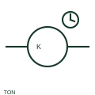

# ANSI/IEEE on-delay timer relay symbol

IEEE-oriented graphical reference for on-delay timer relay, with public vendor evidence and drawing-reading notes.

[Canonical reference](https://eloragrid.ai/symbols/ansi-on-delay-timer-relay) · [Structured record](../entries/ansi-on-delay-timer-relay.json) · [All references](README.md)

Updated: 2026-10-27. Drawing use: Schematic. Reference families: IEEE / ANSI, Manufacturer.

Graphical convention: IEEE / ANSI. Autodesk IEEE-oriented Time Delay Relays functional form.

## What it represents

The on-delay timer operating form identifies a timing element whose specified output transition is postponed after initiation. Trigger, auxiliary supply and delayed output are distinct circuit information, even when the timer assembly combines them.
This is a convention-specific lookup based on the publisher's IEEE-labelled preview. The geometry here is independently drawn to explain the connection or operation; it is not a certified reproduction of the standard graphic.

## How to read it

- Read the start and reset conditions from the timer timing chart.
- Read the selected library and the project legend together. A vendor block identifier is meaningful within its named library and is not a universal standard-symbol code.

## Drawing checklist

- Identify trigger circuit
- State delay setting
- Link delayed contacts

## Important distinction

An on-delay operating element differs from a delayed contact drawn separately under the same timer tag.

## Facts

- Convention evidence: Autodesk IEEE Symbol Preview — Time Delay Relays
- Public vendor block name: HTD1N (Autodesk identifier; not an IEEE symbol number)
- Standards context: IEEE/ANSI 315-1975 covers diagram graphics. IEEE lists this edition as Inactive-Reserved.
- Artwork scope: Original functional illustration; exact standard glyph and compliance are not certified

## Public references

- [Autodesk IEEE Symbol Preview — Time Delay Relays](https://help.autodesk.com/cloudhelp/2021/ENU/AutoCAD-Electrical/files/GUID-BBFF0443-6EA2-4A05-A761-F411E16BA070.htm) — Autodesk. Exact public IEEE-oriented category page verifying the component name and vendor block identifier.
- [IEEE/ANSI 315-1975: graphic symbols for electrical and electronics diagrams](https://standards.ieee.org/ieee/315/515/) — IEEE Standards Association. Graphic-symbol standards context and official status; not a source of reproduced artwork.

## Related references

- [On-delay timer relay](on-delay-timer-relay.md)
- [Relay coil](relay-coil.md)
- [Normally closed contact](normally-closed-contact.md)

Original educational concept geometry, CC BY 4.0. Unitless; not a certified standards glyph or manufacturer footprint.

Elora-authored explanations are CC BY 4.0. Linked standards and manufacturer material retain their own rights. Confirm project requirements using primary sources.
