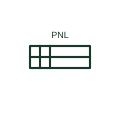

# ANSI panelboard plan symbol

US plan symbol for a panelboard, drawn as a rectangle on the wall with fill indicating flush or surface mounting.

[Canonical reference](https://eloragrid.ai/symbols/ansi-panelboard-plan-symbol) · [Structured record](../entries/ansi-panelboard-plan-symbol.json) · [All references](README.md)

Updated: 2026-10-28. Drawing use: GA. Reference families: IEEE / ANSI.

Graphical convention: IEEE / ANSI. Panelboard.

## What it represents

US plans draw panelboards as rectangles against the wall, with fill or hatching that distinguishes flush-mounted from surface-mounted cabinets. The panel name, such as LP-1A, is written beside it and matches the panel schedule and home-run labels.
The symbol helps coordinate wall depth for flush cabinets and working clearance in front of the panel. Readers should check that the space shown on the plan meets the required clear working space. The symbol does not show bus rating, main breaker or circuit count. These are in the panel schedule.

## How to read it

- Distinguish flush and surface panels by fill.
- Match the label with the panel schedule.

## Drawing checklist

- Name the panel.
- Indicate flush or surface mounting.
- Show working clearance.

## Important distinction

The IEC distribution board plan mark serves the same locating role under a different convention.

## Facts

- Graphic form: Rectangle with fill or hatch on the wall
- Mounting cue: Fill pattern shows flush or surface
- Artwork scope: Original educational illustration; the exact ANSI or IEEE graphic and compliance are not certified

## Public references

- [IEEE/ANSI 315-1975: graphic symbols for electrical and electronics diagrams](https://standards.ieee.org/ieee/315/515/) — IEEE Standards Association. Graphic-symbol standards context; not a source of reproduced artwork.

## Related references

- [Distribution board plan mark](iec-distribution-board-plan-mark.md)
- [Switchboard](switchboard.md)

Original educational concept geometry, CC BY 4.0. Unitless; not a certified standards glyph or manufacturer footprint.

Elora-authored explanations are CC BY 4.0. Linked standards and manufacturer material retain their own rights. Confirm project requirements using primary sources.
