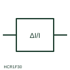

# ANSI/IEEE Percentage-biased differential current relay form

IEEE-library reference for percentage-biased differential current relay, with its operating meaning, connection notes and public vendor block identity.

[Canonical reference](https://eloragrid.ai/symbols/ansi-percentage-differential-current-relay) · [Structured record](../entries/ansi-percentage-differential-current-relay.json) · [All references](README.md)

Updated: 2026-10-28. Drawing use: Schematic, SLD. Reference families: IEEE / ANSI, Manufacturer.

Graphical convention: IEEE / ANSI. Differential Current Protection - Relative Value.

## What it represents

This reference locates percentage-biased differential current relay in Autodesk's IEEE-oriented current protection relays family. This relay form represents differential protection where the operate quantity is the difference between currents entering and leaving a zone, and the threshold is a percentage of the through current. The bias keeps the relay stable when CT errors grow during heavy external faults or transformer tap changes. The public library uses HCR1F30 for its horizontal representation; this is a vendor block name, not an IEEE standards symbol number.
Trace the measured quantity or initiating control signal separately from the output contacts. The device tag links the sensing or operating element to the controlled circuit; settings, reset behaviour and the actual terminal arrangement belong in the selected equipment documentation.
On a drawing the relay box is fed from CT sets at each boundary of the protected zone. The symbol does not show the slope settings, the harmonic restraint used for transformer inrush, or the vector-group and ratio compensation, all of which must be taken from the relay settings record. Locate every CT set that bounds the protected zone. A biased differential relay raises its threshold with through current; a plain differential current relay uses a fixed threshold. The linked functional counterpart explains the same operating role in its own drawing context; agreement of every detailed convention mark is not asserted.

## How to read it

- Locate every CT set that bounds the protected zone.
- Check CT polarity so through current cancels in the relay.

## Drawing checklist

- Show all zone CTs
- Mark CT polarity
- Reference slope and restraint settings

## Important distinction

A biased differential relay raises its threshold with through current; a plain differential current relay uses a fixed threshold.

## Facts

- Convention evidence: Autodesk IEEE Symbol Preview: Current Protection Relays; published form: Differential Current Protection - Relative Value.
- Public vendor block: HCR1F30. Vendor library token, not an IEEE symbol number.
- Measured quantity: Difference current relative to through current
- Preview: Independent educational concept; consult the publisher and applicable standard for the exact graphic
- Artwork scope: Original educational geometry. Exact standard graphics, product ratings and terminal pinouts are not certified.

## Public references

- [Autodesk IEEE Symbol Preview: Current Protection Relays](https://help.autodesk.com/cloudhelp/2021/ENU/AutoCAD-Electrical/files/GUID-EC11EC4D-374C-4191-9534-C802D3932711.htm) — Autodesk. Public IEEE-oriented Current Protection Relays table explicitly lists HCR1F30 as Differential Current Protection - Relative Value. This supports the vendor convention context, not reproduction of the publisher graphic.
- [IEC graphical symbols for diagrams](https://tc3.iec.ch/tc-activity/graphical-symbols-for-diagrams/) — IEC. IEC context for graphical symbols used in diagrams; no IEC graphic is reproduced.

## Related references

- [Percentage-biased differential current relay](percentage-differential-current-relay.md)
- [Differential-current measuring relay](differential-current-measuring-relay.md)
- [Differential protection](87-differential.md)
- [Current transformer](current-transformer.md)

Original educational concept geometry, CC BY 4.0. Unitless; not a certified standards glyph or manufacturer footprint.

Elora-authored explanations are CC BY 4.0. Linked standards and manufacturer material retain their own rights. Confirm project requirements using primary sources.
