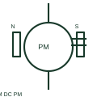

# ANSI/IEEE permanent-magnet dc motor symbol

IEEE-oriented graphical reference for permanent-magnet dc motor, with public vendor evidence and drawing-reading notes.

[Canonical reference](https://eloragrid.ai/symbols/ansi-permanent-magnet-dc-motor) · [Structured record](../entries/ansi-permanent-magnet-dc-motor.json) · [All references](README.md)

Updated: 2026-10-27. Drawing use: SLD, Schematic. Reference families: IEEE / ANSI, Manufacturer.

Graphical convention: IEEE / ANSI. Autodesk IEEE-oriented DC Motors functional form.

## What it represents

The permanent-magnet DC motor form identifies a machine using a permanent magnetic field. Its electrical drawing focuses on armature and control connections while mechanical motor data establishes the driven application and rating.
This is a convention-specific lookup based on the publisher's IEEE-labelled preview. The geometry here is independently drawn to explain the connection or operation; it is not a certified reproduction of the standard graphic.

## How to read it

- Do not add a separate field-supply circuit unless the actual machine requires it.
- Read the selected library and the project legend together. A vendor block identifier is meaningful within its named library and is not a universal standard-symbol code.

## Drawing checklist

- Show armature polarity
- State motor rating
- Reference control arrangement

## Important distinction

Permanent-magnet excitation differs from a separately excited electrical field winding.

## Facts

- Convention evidence: Autodesk IEEE Symbol Preview — DC Motors
- Public vendor block name: HMO1M13 (Autodesk identifier; not an IEEE symbol number)
- Standards context: IEEE/ANSI 315-1975 covers diagram graphics. IEEE lists this edition as Inactive-Reserved.
- Artwork scope: Original functional illustration; exact standard glyph and compliance are not certified

## Public references

- [Autodesk IEEE Symbol Preview — DC Motors](https://help.autodesk.com/cloudhelp/2021/ENU/AutoCAD-Electrical/files/GUID-6A65D995-18BC-4A3C-A34E-C6BB276E8410.htm) — Autodesk. Exact public IEEE-oriented category page verifying the component name and vendor block identifier.
- [IEEE/ANSI 315-1975: graphic symbols for electrical and electronics diagrams](https://standards.ieee.org/ieee/315/515/) — IEEE Standards Association. Graphic-symbol standards context and official status; not a source of reproduced artwork.

## Related references

- [Permanent-magnet DC motor](permanent-magnet-dc-motor.md)
- [Three-phase motor](motor.md)
- [Contactor](contactor.md)

Original educational concept geometry, CC BY 4.0. Unitless; not a certified standards glyph or manufacturer footprint.

Elora-authored explanations are CC BY 4.0. Linked standards and manufacturer material retain their own rights. Confirm project requirements using primary sources.
