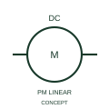

# ANSI/IEEE Permanent-magnet linear DC motor form

IEEE-library form of permanent-magnet linear dc motor: this representation identifies linear motion produced by a permanent-magnet DC machine.

[Canonical reference](https://eloragrid.ai/symbols/ansi-permanent-magnet-linear-dc-motor) · [Structured record](../entries/ansi-permanent-magnet-linear-dc-motor.json) · [All references](README.md)

Updated: 2026-10-28. Drawing use: SLD, Schematic. Reference families: IEEE / ANSI, Manufacturer.

Graphical convention: IEEE / ANSI. DC Motor - Linear with Permanent Magnets.

## What it represents

This reference locates permanent-magnet linear dc motor in Autodesk's IEEE-oriented dc motors family. This representation identifies linear motion produced by a permanent-magnet DC machine. The public library uses HMO1M14 for its horizontal representation; this is a vendor block name, not an IEEE standards symbol number.
Trace each winding, supply and accessible neutral through the complete machine or transformer connection diagram. Keep the phase arrangement, terminal labels and any clock notation attached to the device; neither the convention label nor this educational outline supplies its ratings.
Show the drive interface and mechanically driven axis or load. A linear motor is not simply a rotated rotary-motor drawing. Show the drive interface and mechanically driven axis or load. A linear motor is not simply a rotated rotary-motor drawing. The linked functional counterpart explains the same operating role in its own drawing context; agreement of every detailed convention mark is not asserted.

## How to read it

- Show the drive interface and mechanically driven axis or load.
- A linear motor is not simply a rotated rotary-motor drawing.

## Drawing checklist

- Identify the associated device, circuit or diagram boundary.
- Show the drive interface and mechanically driven axis or load.
- Cross-reference the equipment data, terminal mapping or operating-state legend needed to interpret the form.

## Important distinction

A linear motor is not simply a rotated rotary-motor drawing.

## Facts

- Convention evidence: Autodesk IEEE Symbol Preview: DC Motors; published form: DC Motor - Linear with Permanent Magnets.
- Public vendor block: HMO1M14. Vendor library token, not an IEEE symbol number.
- Information added: Show the drive interface and mechanically driven axis or load.
- Preview: Independent educational concept; consult the publisher and applicable standard for the exact graphic
- Artwork scope: Original educational geometry. Exact standard graphics, product ratings and terminal pinouts are not certified.

## Public references

- [Autodesk IEEE Symbol Preview — DC Motors](https://help.autodesk.com/cloudhelp/2021/ENU/AutoCAD-Electrical/files/GUID-6A65D995-18BC-4A3C-A34E-C6BB276E8410.htm) — Autodesk. Public IEEE-oriented DC Motors table explicitly lists HMO1M14 as DC Motor - Linear with Permanent Magnets. This supports the vendor convention context, not reproduction of the publisher graphic.

## Related references

- [Permanent-magnet linear DC motor](iec-permanent-magnet-linear-dc-motor.md)
- [Three-phase motor](motor.md)
- [Generator](generator.md)

Original educational concept geometry, CC BY 4.0. Unitless; not a certified standards glyph or manufacturer footprint.

Elora-authored explanations are CC BY 4.0. Linked standards and manufacturer material retain their own rights. Confirm project requirements using primary sources.
