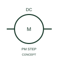

# ANSI/IEEE Permanent-magnet stepping motor form

IEEE-library form of permanent-magnet stepping motor: this representation identifies a permanent-magnet stepping-motor function.

[Canonical reference](https://eloragrid.ai/symbols/ansi-permanent-magnet-stepping-motor) · [Structured record](../entries/ansi-permanent-magnet-stepping-motor.json) · [All references](README.md)

Updated: 2026-10-28. Drawing use: SLD, Schematic. Reference families: IEEE / ANSI, Manufacturer.

Graphical convention: IEEE / ANSI. DC Motor - Stepping with Permanent Magnets.

## What it represents

This reference locates permanent-magnet stepping motor in Autodesk's IEEE-oriented dc motors family. This representation identifies a permanent-magnet stepping-motor function. The public library uses HMO1M15 for its horizontal representation; this is a vendor block name, not an IEEE standards symbol number.
Trace each winding, supply and accessible neutral through the complete machine or transformer connection diagram. Keep the phase arrangement, terminal labels and any clock notation attached to the device; neither the convention label nor this educational outline supplies its ratings.
Cross-reference the phase/drive connections and the specified step-control interface. A stepping motor requires a drive sequence rather than an ordinary continuously applied DC supply assumption. Cross-reference the phase/drive connections and the specified step-control interface. A stepping motor requires a drive sequence rather than an ordinary continuously applied DC supply assumption. The linked functional counterpart explains the same operating role in its own drawing context; agreement of every detailed convention mark is not asserted.

## How to read it

- Cross-reference the phase/drive connections and the specified step-control interface.
- A stepping motor requires a drive sequence rather than an ordinary continuously applied DC supply assumption.

## Drawing checklist

- Identify the associated device, circuit or diagram boundary.
- Cross-reference the phase/drive connections and the specified step-control interface.
- Cross-reference the equipment data, terminal mapping or operating-state legend needed to interpret the form.

## Important distinction

A stepping motor requires a drive sequence rather than an ordinary continuously applied DC supply assumption.

## Facts

- Convention evidence: Autodesk IEEE Symbol Preview: DC Motors; published form: DC Motor - Stepping with Permanent Magnets.
- Public vendor block: HMO1M15. Vendor library token, not an IEEE symbol number.
- Information added: Cross-reference the phase/drive connections and the specified step-control interface.
- Preview: Independent educational concept; consult the publisher and applicable standard for the exact graphic
- Artwork scope: Original educational geometry. Exact standard graphics, product ratings and terminal pinouts are not certified.

## Public references

- [Autodesk IEEE Symbol Preview — DC Motors](https://help.autodesk.com/cloudhelp/2021/ENU/AutoCAD-Electrical/files/GUID-6A65D995-18BC-4A3C-A34E-C6BB276E8410.htm) — Autodesk. Public IEEE-oriented DC Motors table explicitly lists HMO1M15 as DC Motor - Stepping with Permanent Magnets. This supports the vendor convention context, not reproduction of the publisher graphic.

## Related references

- [Permanent-magnet stepping motor](iec-permanent-magnet-stepping-motor.md)
- [Three-phase motor](motor.md)
- [Generator](generator.md)

Original educational concept geometry, CC BY 4.0. Unitless; not a certified standards glyph or manufacturer footprint.

Elora-authored explanations are CC BY 4.0. Linked standards and manufacturer material retain their own rights. Confirm project requirements using primary sources.
