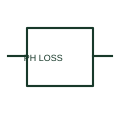

# ANSI/IEEE Phase-loss monitoring relay form

IEEE-library form of phase-loss monitoring relay: a phase-loss relay supervises the presence of the specified phases in a three-phase system.

[Canonical reference](https://eloragrid.ai/symbols/ansi-phase-loss-monitoring-relay) · [Structured record](../entries/ansi-phase-loss-monitoring-relay.json) · [All references](README.md)

Updated: 2026-10-28. Drawing use: SLD, Schematic. Reference families: IEEE / ANSI, Manufacturer.

Graphical convention: IEEE / ANSI. Relay Sensing Lack of Phase in Three Phase System.

## What it represents

This reference locates phase-loss monitoring relay in Autodesk's IEEE-oriented miscellaneous relays family. A phase-loss relay supervises the presence of the specified phases in a three-phase system. The drawing identifies the monitored source and output used by control or protection logic. The public library uses HCR1F42 for its horizontal representation; this is a vendor block name, not an IEEE standards symbol number.
Trace the measured quantity or initiating control signal separately from the output contacts. The device tag links the sensing or operating element to the controlled circuit; settings, reset behaviour and the actual terminal arrangement belong in the selected equipment documentation.
Check whether phase sequence or voltage unbalance is also configured in the selected device. Phase loss is different from phase reversal or current unbalance. The linked functional counterpart explains the same operating role in its own drawing context; agreement of every detailed convention mark is not asserted.

## How to read it

- Check whether phase sequence or voltage unbalance is also configured in the selected device.
- The preview is an original explanation of this function. Match the actual drawing convention to its legend and the selected equipment documentation.

## Drawing checklist

- Show phase measurement inputs
- State enabled functions
- Reference output logic

## Important distinction

Phase loss is different from phase reversal or current unbalance.

## Facts

- Convention evidence: Autodesk IEEE Symbol Preview: Miscellaneous Relays; published form: Relay Sensing Lack of Phase in Three Phase System.
- Public vendor block: HCR1F42. Vendor library token, not an IEEE symbol number.
- Drawing role: Monitoring element
- Identifier status: The short label is a functional lookup label, not an assigned IEC or IEEE symbol number. Any separately listed Autodesk code is a verified vendor block name.
- Artwork scope: Original educational geometry. Exact standard graphics, product ratings and terminal pinouts are not certified.

## Public references

- [Autodesk IEEE Symbol Preview: Miscellaneous Relays](https://help.autodesk.com/cloudhelp/2021/ENU/AutoCAD-Electrical/files/GUID-DA549E3E-4ABB-426E-9331-0226EF55EAA7.htm) — Autodesk. Public IEEE-oriented Miscellaneous Relays table explicitly lists HCR1F42 as Relay Sensing Lack of Phase in Three Phase System. This supports the vendor convention context, not reproduction of the publisher graphic.

## Related references

- [Phase-loss monitoring relay](phase-loss-monitoring-relay.md)
- [Current transformer](current-transformer.md)
- [Relay coil](relay-coil.md)

Original educational concept geometry, CC BY 4.0. Unitless; not a certified standards glyph or manufacturer footprint.

Elora-authored explanations are CC BY 4.0. Linked standards and manufacturer material retain their own rights. Confirm project requirements using primary sources.
