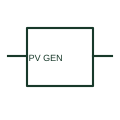

# ANSI/IEEE Photovoltaic generator form

IEEE-library form of photovoltaic generator: a photovoltaic generator represents the electrical production of PV cells or modules.

[Canonical reference](https://eloragrid.ai/symbols/ansi-photovoltaic-generator) · [Structured record](../entries/ansi-photovoltaic-generator.json) · [All references](README.md)

Updated: 2026-10-28. Drawing use: SLD, Schematic. Reference families: IEEE / ANSI, Manufacturer.

Graphical convention: IEEE / ANSI. Photovoltaic Generator.

## What it represents

This reference locates photovoltaic generator in Autodesk's IEEE-oriented electronics family. A photovoltaic generator represents the electrical production of PV cells or modules. On an SLD it is linked to documented series/parallel strings, DC protection and the inverter interface. The public library uses HPW1\_S00908 for its horizontal representation; this is a vendor block name, not an IEEE standards symbol number.
Use the surrounding circuit labels and the project legend to identify the intended operating condition and connection. Carry the same device reference into the schedule or equipment document so the symbol can be reconciled with its real terminals, function and operating limits.
Differentiate the generating array from its inverter and any energy-storage branch. The PV generator is a DC generating function; the inverter produces the documented AC interface. The linked functional counterpart explains the same operating role in its own drawing context; agreement of every detailed convention mark is not asserted.

## How to read it

- Differentiate the generating array from its inverter and any energy-storage branch.
- The preview is an original explanation of this function. Match the actual drawing convention to its legend and the selected equipment documentation.

## Drawing checklist

- Reference module/string arrangement
- State DC ratings
- Show connected inverter/protection

## Important distinction

The PV generator is a DC generating function; the inverter produces the documented AC interface.

## Facts

- Convention evidence: Autodesk IEEE Symbol Preview: Electronics; published form: Photovoltaic Generator.
- Public vendor block: HPW1\_S00908. Vendor library token, not an IEEE symbol number.
- Drawing role: Supply or network role
- Identifier status: The short label is a functional lookup label, not an assigned IEC or IEEE symbol number. Any separately listed Autodesk code is a verified vendor block name.
- Artwork scope: Original educational geometry. Exact standard graphics, product ratings and terminal pinouts are not certified.

## Public references

- [Autodesk IEEE Symbol Preview: Electronics](https://help.autodesk.com/cloudhelp/2021/ENU/AutoCAD-Electrical/files/GUID-861363BD-49C1-4951-8114-1559F4D887CE.htm) — Autodesk. Public IEEE-oriented Electronics table explicitly lists HPW1\_S00908 as Photovoltaic Generator. This supports the vendor convention context, not reproduction of the publisher graphic.

## Related references

- [Photovoltaic generator](photovoltaic-generator.md)
- [Generator](generator.md)
- [Busbar](busbar.md)

Original educational concept geometry, CC BY 4.0. Unitless; not a certified standards glyph or manufacturer footprint.

Elora-authored explanations are CC BY 4.0. Linked standards and manufacturer material retain their own rights. Confirm project requirements using primary sources.
