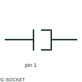

# ANSI/IEEE plug and socket connector pair symbol

IEEE-oriented graphical reference for plug and socket connector pair, with public vendor evidence and drawing-reading notes.

[Canonical reference](https://eloragrid.ai/symbols/ansi-plug-and-socket-connector-pair) · [Structured record](../entries/ansi-plug-and-socket-connector-pair.json) · [All references](README.md)

Updated: 2026-10-27. Drawing use: Schematic. Reference families: IEEE / ANSI, Manufacturer.

Graphical convention: IEEE / ANSI. Autodesk IEEE-oriented Connectors - No Wirenumber Changes functional form.

## What it represents

The plug/jack form identifies a detachable mating connection with two corresponding sides. The conductor path passes through a defined pin interface; plug name, socket name and mating references remain necessary for practical wiring.
This is a convention-specific lookup based on the publisher's IEEE-labelled preview. The geometry here is independently drawn to explain the connection or operation; it is not a certified reproduction of the standard graphic.

## How to read it

- Verify the pin-view convention on both halves.
- Read the selected library and the project legend together. A vendor block identifier is meaningful within its named library and is not a universal standard-symbol code.

## Drawing checklist

- Name connector halves
- Identify pin pair
- Reference mating view

## Important distinction

A detachable connector interface differs from a permanent splice or a terminal bridge.

## Facts

- Convention evidence: Autodesk IEEE Symbol Preview — Connectors - No Wirenumber Changes
- Public vendor block name: HC01PJ (Autodesk identifier; not an IEEE symbol number)
- Standards context: IEEE/ANSI 315-1975 covers diagram graphics. IEEE lists this edition as Inactive-Reserved.
- Artwork scope: Original functional illustration; exact standard glyph and compliance are not certified

## Public references

- [Autodesk IEEE Symbol Preview — Connectors - No Wirenumber Changes](https://help.autodesk.com/cloudhelp/2021/ENU/AutoCAD-Electrical/files/GUID-0B14FEAB-110A-4DD3-884E-0A2F8F9E76F7.htm) — Autodesk. Exact public IEEE-oriented category page verifying the component name and vendor block identifier.
- [IEEE/ANSI 315-1975: graphic symbols for electrical and electronics diagrams](https://standards.ieee.org/ieee/315/515/) — IEEE Standards Association. Graphic-symbol standards context and official status; not a source of reproduced artwork.

## Related references

- [Plug and socket connector pair](plug-and-socket-connector-pair.md)
- [Terminal connection](terminal.md)
- [PLC input / output](plc-io.md)

Original educational concept geometry, CC BY 4.0. Unitless; not a certified standards glyph or manufacturer footprint.

Elora-authored explanations are CC BY 4.0. Linked standards and manufacturer material retain their own rights. Confirm project requirements using primary sources.
