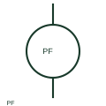

# ANSI/IEEE power-factor meter symbol

IEEE-oriented graphical reference for power-factor meter, with public vendor evidence and drawing-reading notes.

[Canonical reference](https://eloragrid.ai/symbols/ansi-power-factor-meter) · [Structured record](../entries/ansi-power-factor-meter.json) · [All references](README.md)

Updated: 2026-10-27. Drawing use: SLD, Schematic. Reference families: IEEE / ANSI, Manufacturer.

Graphical convention: IEEE / ANSI. Autodesk IEEE-oriented Instrumentation and Sensors functional form.

## What it represents

The power-factor meter form indicates a relationship derived from documented voltage and current inputs. Phase association and sign convention affect interpretation, while total versus displacement power factor depends on the instrument's method.
This is a convention-specific lookup based on the publisher's IEEE-labelled preview. The geometry here is independently drawn to explain the connection or operation; it is not a certified reproduction of the standard graphic.

## How to read it

- Check the reported power-factor convention before comparing indications.
- Read the selected library and the project legend together. A vendor block identifier is meaningful within its named library and is not a universal standard-symbol code.

## Drawing checklist

- Show voltage/current phases
- State measurement convention
- Reference CT/VT scaling

## Important distinction

Power factor is a ratio, not reactive power measured in var.

## Facts

- Convention evidence: Autodesk IEEE Symbol Preview — Instrumentation and Sensors
- Public vendor block name: HIN1PFM (Autodesk identifier; not an IEEE symbol number)
- Standards context: IEEE/ANSI 315-1975 covers diagram graphics. IEEE lists this edition as Inactive-Reserved.
- Artwork scope: Original functional illustration; exact standard glyph and compliance are not certified

## Public references

- [Autodesk IEEE Symbol Preview — Instrumentation and Sensors](https://help.autodesk.com/cloudhelp/2021/ENU/AutoCAD-Electrical/files/GUID-F44D5059-4728-40BD-B9BA-0DE7CFDFAACF.htm) — Autodesk. Exact public IEEE-oriented category page verifying the component name and vendor block identifier.
- [IEEE/ANSI 315-1975: graphic symbols for electrical and electronics diagrams](https://standards.ieee.org/ieee/315/515/) — IEEE Standards Association. Graphic-symbol standards context and official status; not a source of reproduced artwork.

## Related references

- [Power-factor meter](power-factor-meter.md)
- [Current transformer](current-transformer.md)
- [Voltage transformer](voltage-transformer.md)

Original educational concept geometry, CC BY 4.0. Unitless; not a certified standards glyph or manufacturer footprint.

Elora-authored explanations are CC BY 4.0. Linked standards and manufacturer material retain their own rights. Confirm project requirements using primary sources.
