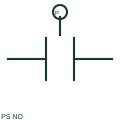

# ANSI/IEEE pressure switch no symbol

IEEE-oriented graphical reference for pressure switch no, with public vendor evidence and drawing-reading notes.

[Canonical reference](https://eloragrid.ai/symbols/ansi-pressure-switch-no) · [Structured record](../entries/ansi-pressure-switch-no.json) · [All references](README.md)

Updated: 2026-10-27. Drawing use: Schematic. Reference families: IEEE / ANSI, Manufacturer.

Graphical convention: IEEE / ANSI. Autodesk IEEE-oriented Pressure and Temperature Switches functional form.

## What it represents

The pressure-operated NO form links a contact state to a documented pressure condition. The process direction and reset differential must be supplied separately because an open reference contact does not establish a high- or low-pressure threshold.
This is a convention-specific lookup based on the publisher's IEEE-labelled preview. The geometry here is independently drawn to explain the connection or operation; it is not a certified reproduction of the standard graphic.

## How to read it

- Identify whether rising or falling pressure produces operation.
- Read the selected library and the project legend together. A vendor block identifier is meaningful within its named library and is not a universal standard-symbol code.

## Drawing checklist

- Name pressure service
- State operate/reset conditions
- Reference terminal pair

## Important distinction

Pressure process action and NO contact reference state are different pieces of information.

## Facts

- Convention evidence: Autodesk IEEE Symbol Preview — Pressure and Temperature Switches
- Public vendor block name: HPS11 (Autodesk identifier; not an IEEE symbol number)
- Standards context: IEEE/ANSI 315-1975 covers diagram graphics. IEEE lists this edition as Inactive-Reserved.
- Artwork scope: Original functional illustration; exact standard glyph and compliance are not certified

## Public references

- [Autodesk IEEE Symbol Preview — Pressure and Temperature Switches](https://help.autodesk.com/cloudhelp/2021/ENU/AutoCAD-Electrical/files/GUID-FB8B55DB-CBA8-4A86-B8D1-AA59012F1A8E.htm) — Autodesk. Exact public IEEE-oriented category page verifying the component name and vendor block identifier.
- [IEEE/ANSI 315-1975: graphic symbols for electrical and electronics diagrams](https://standards.ieee.org/ieee/315/515/) — IEEE Standards Association. Graphic-symbol standards context and official status; not a source of reproduced artwork.

## Related references

- [Pressure switch NO](pressure-switch-no.md)
- [PLC input / output](plc-io.md)
- [Normally open contact](normally-open-contact.md)

Original educational concept geometry, CC BY 4.0. Unitless; not a certified standards glyph or manufacturer footprint.

Elora-authored explanations are CC BY 4.0. Linked standards and manufacturer material retain their own rights. Confirm project requirements using primary sources.
