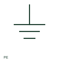

# ANSI/IEEE protective earth symbol

IEEE-oriented graphical reference for protective earth, with public vendor evidence and drawing-reading notes.

[Canonical reference](https://eloragrid.ai/symbols/ansi-protective-earth) · [Structured record](../entries/ansi-protective-earth.json) · [All references](README.md)

Updated: 2026-10-27. Drawing use: SLD, Schematic. Reference families: IEEE / ANSI, Manufacturer.

Graphical convention: IEEE / ANSI. Autodesk IEEE-oriented Miscellaneous functional form.

## What it represents

The protective-earth form identifies a connection serving the documented protective conductor arrangement. Its role must be read with the device terminal designation and the installation's bonding paths, rather than treating all ground-like marks as one signal common.
This is a convention-specific lookup based on the publisher's IEEE-labelled preview. The geometry here is independently drawn to explain the connection or operation; it is not a certified reproduction of the standard graphic.

## How to read it

- Trace the connection to the assembly's protective-earth network.
- Read the selected library and the project legend together. A vendor block identifier is meaningful within its named library and is not a universal standard-symbol code.

## Drawing checklist

- Identify PE terminal/conductor
- Show bonding path
- Reference installation earthing detail

## Important distinction

Protective earth differs in purpose from functional earth and from an arbitrary signal reference.

## Facts

- Convention evidence: Autodesk IEEE Symbol Preview — Miscellaneous
- Public vendor block name: HGND4 (Autodesk identifier; not an IEEE symbol number)
- Standards context: IEEE/ANSI 315-1975 covers diagram graphics. IEEE lists this edition as Inactive-Reserved.
- Artwork scope: Original functional illustration; exact standard glyph and compliance are not certified

## Public references

- [Autodesk IEEE Symbol Preview — Miscellaneous](https://help.autodesk.com/cloudhelp/2021/ENU/AutoCAD-Electrical/files/GUID-34282BFD-7B8E-48F3-A6ED-93ADBDDDFBD3.htm) — Autodesk. Exact public IEEE-oriented category page verifying the component name and vendor block identifier.
- [IEEE/ANSI 315-1975: graphic symbols for electrical and electronics diagrams](https://standards.ieee.org/ieee/315/515/) — IEEE Standards Association. Graphic-symbol standards context and official status; not a source of reproduced artwork.

## Related references

- [Protective earth](protective-earth.md)
- [Earthing switch](earthing-switch.md)
- [Terminal connection](terminal.md)
- [Control / marshalling cabinet](control-cabinet.md)

Original educational concept geometry, CC BY 4.0. Unitless; not a certified standards glyph or manufacturer footprint.

Elora-authored explanations are CC BY 4.0. Linked standards and manufacturer material retain their own rights. Confirm project requirements using primary sources.
