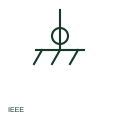

# ANSI/IEEE protective equipotential bonding symbol

IEEE-oriented protective equipotential bond, connecting exposed metal parts together for safety.

[Canonical reference](https://eloragrid.ai/symbols/ansi-protective-equipotential-bonding) · [Structured record](../entries/ansi-protective-equipotential-bonding.json) · [All references](README.md)

Updated: 2026-10-28. Drawing use: Schematic. Reference families: IEEE / ANSI, Manufacturer.

Graphical convention: IEEE / ANSI. Autodesk IEEE-oriented protective equipotential bond form.

## What it represents

The protective equipotential bond connects exposed and extraneous conductive parts so that dangerous touch voltages cannot develop between them during a fault. The publisher's IEEE miscellaneous preview lists a protective equipotential bond form, which is the US-practice counterpart of the existing IEC page.
This illustration is an independent explanation and not the IEEE graphic. The bond symbol does not state conductor size or the parts bonded; those belong in bonding schedules. In US terminology this aligns with equipment bonding, which is distinct from the main bonding jumper at the service.

## How to read it

- Identify the parts bonded at each symbol.
- Distinguish equipment bonding from the service bonding jumper.

## Drawing checklist

- Schedule bonding conductor sizes.
- Label bonded parts.
- Keep protective and functional bonds distinct.

## Important distinction

A protective bond is for safety; a functional bond is for equipment operation or noise control.

## Facts

- Convention evidence: Autodesk IEEE Symbol Preview: Miscellaneous (Protective equipotential bond)
- Public vendor block name: HGND5 (Autodesk identifier; not an IEEE symbol number)
- Standards context: IEEE/ANSI 315-1975 covers diagram graphics; IEEE lists this edition as Inactive-Reserved.
- Preview: Original educational illustration; consult the publisher and applicable standard for the exact graphic

## Public references

- [Autodesk IEEE Symbol Preview — Miscellaneous](https://help.autodesk.com/cloudhelp/2021/ENU/AutoCAD-Electrical/files/GUID-34282BFD-7B8E-48F3-A6ED-93ADBDDDFBD3.htm) — Autodesk. Exact public IEEE-oriented category page listing the protective equipotential bond form.
- [IEEE/ANSI 315-1975: graphic symbols for electrical and electronics diagrams](https://standards.ieee.org/ieee/315/515/) — IEEE Standards Association. Graphic-symbol standards context and official status; not a source of reproduced artwork.

## Related references

- [Protective equipotential bonding](protective-equipotential-bonding.md)
- [ANSI/IEEE functional equipotential bonding symbol](ansi-functional-equipotential-bonding.md)
- [ANSI/IEEE main bonding jumper symbol](ansi-main-bonding-jumper.md)

Original educational concept geometry, CC BY 4.0. Unitless; not a certified standards glyph or manufacturer footprint.

Elora-authored explanations are CC BY 4.0. Linked standards and manufacturer material retain their own rights. Confirm project requirements using primary sources.
