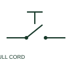

# ANSI/IEEE Pull-cord switch form

IEEE-library form of pull-cord switch: a pull-cord switch converts a cord-operated mechanical action into an electrical contact change.

[Canonical reference](https://eloragrid.ai/symbols/ansi-pull-cord-switch) · [Structured record](../entries/ansi-pull-cord-switch.json) · [All references](README.md)

Updated: 2026-10-28. Drawing use: Schematic. Reference families: IEEE / ANSI, Manufacturer.

Graphical convention: IEEE / ANSI. Pull Cord Switch, Normally Closed.

## What it represents

This reference locates pull-cord switch in Autodesk's IEEE-oriented miscellaneous switches family. A pull-cord switch converts a cord-operated mechanical action into an electrical contact change. The control drawing records the contact function, while the layout records the cord route and actuator placement. The public library uses HPC12 for its horizontal representation; this is a vendor block name, not an IEEE standards symbol number.
Read the operating mechanism and the contact reference state together. Cross-reference every associated contact to the same device and show which movement, signal or reset changes its condition; the symbol alone does not establish the complete switching sequence.
State the normal condition and how operation is reset. A generic pull-cord symbol does not certify an emergency-stop function. The linked functional counterpart explains the same operating role in its own drawing context; agreement of every detailed convention mark is not asserted.

## How to read it

- State the normal condition and how operation is reset.
- The preview is an original explanation of this function. Match the actual drawing convention to its legend and the selected equipment documentation.

## Drawing checklist

- Identify contact action
- Reference cord arrangement
- Show reset mechanism

## Important distinction

A generic pull-cord symbol does not certify an emergency-stop function.

## Facts

- Convention evidence: Autodesk IEEE Symbol Preview: Miscellaneous Switches; published form: Pull Cord Switch, Normally Closed.
- Public vendor block: HPC12. Vendor library token, not an IEEE symbol number.
- Drawing role: Manual operation
- Identifier status: The short label is a functional lookup label, not an assigned IEC or IEEE symbol number. Any separately listed Autodesk code is a verified vendor block name.
- Artwork scope: Original educational geometry. Exact standard graphics, product ratings and terminal pinouts are not certified.

## Public references

- [Autodesk IEEE Symbol Preview — Miscellaneous Switches](https://help.autodesk.com/cloudhelp/2021/ENU/AutoCAD-Electrical/files/GUID-278F6C21-B1A6-4EA1-A535-E78D53BBD10D.htm) — Autodesk. Public IEEE-oriented Miscellaneous Switches table explicitly lists HPC12 as Pull Cord Switch, Normally Closed. This supports the vendor convention context, not reproduction of the publisher graphic.

## Related references

- [Pull-cord switch](pull-cord-switch.md)
- [Normally open pushbutton](pushbutton-no.md)
- [Normally closed pushbutton](pushbutton-nc.md)

Original educational concept geometry, CC BY 4.0. Unitless; not a certified standards glyph or manufacturer footprint.

Elora-authored explanations are CC BY 4.0. Linked standards and manufacturer material retain their own rights. Confirm project requirements using primary sources.
