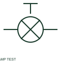

# ANSI/IEEE push-to-test indicator lamp symbol

IEEE-oriented graphical reference for push-to-test indicator lamp, with public vendor evidence and drawing-reading notes.

[Canonical reference](https://eloragrid.ai/symbols/ansi-push-to-test-indicator-lamp) · [Structured record](../entries/ansi-push-to-test-indicator-lamp.json) · [All references](README.md)

Updated: 2026-10-27. Drawing use: Schematic. Reference families: IEEE / ANSI, Manufacturer.

Graphical convention: IEEE / ANSI. Autodesk IEEE-oriented Push to Test Lights functional form.

## What it represents

The press-to-test lamp form combines indication and a documented local test path. The normal signal and test supply may be different circuit paths, and the test does not automatically verify the monitored equipment feedback.
This is a convention-specific lookup based on the publisher's IEEE-labelled preview. The geometry here is independently drawn to explain the connection or operation; it is not a certified reproduction of the standard graphic.

## How to read it

- Trace the test path independently of the normal alarm or status contact.
- Read the selected library and the project legend together. A vendor block identifier is meaningful within its named library and is not a universal standard-symbol code.

## Drawing checklist

- Identify normal signal
- Show test connection
- State lamp supply

## Important distinction

A lamp-test operation and a complete alarm-system test are different verification functions.

## Facts

- Convention evidence: Autodesk IEEE Symbol Preview — Push to Test Lights
- Public vendor block name: HLT1RP (Autodesk identifier; not an IEEE symbol number)
- Standards context: IEEE/ANSI 315-1975 covers diagram graphics. IEEE lists this edition as Inactive-Reserved.
- Artwork scope: Original functional illustration; exact standard glyph and compliance are not certified

## Public references

- [Autodesk IEEE Symbol Preview — Push to Test Lights](https://help.autodesk.com/cloudhelp/2021/ENU/AutoCAD-Electrical/files/GUID-75E2013F-4032-43F0-AA2B-800C82135188.htm) — Autodesk. Exact public IEEE-oriented category page verifying the component name and vendor block identifier.
- [IEEE/ANSI 315-1975: graphic symbols for electrical and electronics diagrams](https://standards.ieee.org/ieee/315/515/) — IEEE Standards Association. Graphic-symbol standards context and official status; not a source of reproduced artwork.

## Related references

- [Push-to-test indicator lamp](push-to-test-indicator-lamp.md)
- [Indicator lamp](indicator-lamp.md)
- [Relay coil](relay-coil.md)

Original educational concept geometry, CC BY 4.0. Unitless; not a certified standards glyph or manufacturer footprint.

Elora-authored explanations are CC BY 4.0. Linked standards and manufacturer material retain their own rights. Confirm project requirements using primary sources.
