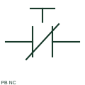

# ANSI/IEEE normally closed pushbutton symbol

IEEE-oriented graphical reference for normally closed pushbutton, with public vendor evidence and drawing-reading notes.

[Canonical reference](https://eloragrid.ai/symbols/ansi-pushbutton-nc) · [Structured record](../entries/ansi-pushbutton-nc.json) · [All references](README.md)

Updated: 2026-10-27. Drawing use: Schematic. Reference families: IEEE / ANSI, Manufacturer.

Graphical convention: IEEE / ANSI. Autodesk IEEE-oriented Push Buttons functional form.

## What it represents

The momentary NC pushbutton form describes a normally continuous path opened by the operator. Its circuit role can be stop, inhibit or another command, but that purpose comes from the wiring and label rather than from NC alone.
This is a convention-specific lookup based on the publisher's IEEE-labelled preview. The geometry here is independently drawn to explain the connection or operation; it is not a certified reproduction of the standard graphic.

## How to read it

- Evaluate the path before, during and after operation.
- Read the selected library and the project legend together. A vendor block identifier is meaningful within its named library and is not a universal standard-symbol code.

## Drawing checklist

- Name commanded function
- Show terminal pair
- State return behaviour

## Important distinction

An NC contact form does not by itself identify a complete emergency-stop safety circuit.

## Facts

- Convention evidence: Autodesk IEEE Symbol Preview — Push Buttons
- Public vendor block name: HPB12 (Autodesk identifier; not an IEEE symbol number)
- Standards context: IEEE/ANSI 315-1975 covers diagram graphics. IEEE lists this edition as Inactive-Reserved.
- Artwork scope: Original functional illustration; exact standard glyph and compliance are not certified

## Public references

- [Autodesk IEEE Symbol Preview — Push Buttons](https://help.autodesk.com/cloudhelp/2021/ENU/AutoCAD-Electrical/files/GUID-863A2EB5-8ECD-4348-90C7-49A37DE11B8B.htm) — Autodesk. Exact public IEEE-oriented category page verifying the component name and vendor block identifier.
- [IEEE/ANSI 315-1975: graphic symbols for electrical and electronics diagrams](https://standards.ieee.org/ieee/315/515/) — IEEE Standards Association. Graphic-symbol standards context and official status; not a source of reproduced artwork.

## Related references

- [Normally closed pushbutton](pushbutton-nc.md)
- [Normally open pushbutton](pushbutton-no.md)
- [Emergency-stop operator](emergency-stop.md)
- [Normally closed contact](normally-closed-contact.md)

Original educational concept geometry, CC BY 4.0. Unitless; not a certified standards glyph or manufacturer footprint.

Elora-authored explanations are CC BY 4.0. Linked standards and manufacturer material retain their own rights. Confirm project requirements using primary sources.
