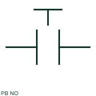

# ANSI/IEEE normally open pushbutton symbol

IEEE-oriented graphical reference for normally open pushbutton, with public vendor evidence and drawing-reading notes.

[Canonical reference](https://eloragrid.ai/symbols/ansi-pushbutton-no) · [Structured record](../entries/ansi-pushbutton-no.json) · [All references](README.md)

Updated: 2026-10-27. Drawing use: Schematic. Reference families: IEEE / ANSI, Manufacturer.

Graphical convention: IEEE / ANSI. Autodesk IEEE-oriented Push Buttons functional form.

## What it represents

The momentary NO pushbutton form associates an operator action with an initially open contact. Read the actuator and contact together, then identify the control path that becomes continuous while the button is operated.
This is a convention-specific lookup based on the publisher's IEEE-labelled preview. The geometry here is independently drawn to explain the connection or operation; it is not a certified reproduction of the standard graphic.

## How to read it

- Keep the operator's release action separate from any electrical holding circuit.
- Read the selected library and the project legend together. A vendor block identifier is meaningful within its named library and is not a universal standard-symbol code.

## Drawing checklist

- State operator function
- Show contact terminals
- Reference controlled circuit

## Important distinction

A momentary pushbutton returns mechanically; a latched pushbutton retains its position.

## Facts

- Convention evidence: Autodesk IEEE Symbol Preview — Push Buttons
- Public vendor block name: HPB11 (Autodesk identifier; not an IEEE symbol number)
- Standards context: IEEE/ANSI 315-1975 covers diagram graphics. IEEE lists this edition as Inactive-Reserved.
- Artwork scope: Original functional illustration; exact standard glyph and compliance are not certified

## Public references

- [Autodesk IEEE Symbol Preview — Push Buttons](https://help.autodesk.com/cloudhelp/2021/ENU/AutoCAD-Electrical/files/GUID-863A2EB5-8ECD-4348-90C7-49A37DE11B8B.htm) — Autodesk. Exact public IEEE-oriented category page verifying the component name and vendor block identifier.
- [IEEE/ANSI 315-1975: graphic symbols for electrical and electronics diagrams](https://standards.ieee.org/ieee/315/515/) — IEEE Standards Association. Graphic-symbol standards context and official status; not a source of reproduced artwork.

## Related references

- [Normally open pushbutton](pushbutton-no.md)
- [Normally closed pushbutton](pushbutton-nc.md)
- [Normally open contact](normally-open-contact.md)
- [Selector switch](selector-switch.md)

Original educational concept geometry, CC BY 4.0. Unitless; not a certified standards glyph or manufacturer footprint.

Elora-authored explanations are CC BY 4.0. Linked standards and manufacturer material retain their own rights. Confirm project requirements using primary sources.
