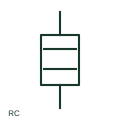

# ANSI/IEEE RC network form

IEEE-library form of rc network: an RC network combines resistance and capacitance in a specified circuit arrangement.

[Canonical reference](https://eloragrid.ai/symbols/ansi-rc-network) · [Structured record](../entries/ansi-rc-network.json) · [All references](README.md)

Updated: 2026-10-28. Drawing use: SLD, Schematic. Reference families: IEEE / ANSI, Manufacturer.

Graphical convention: IEEE / ANSI. RC Network.

## What it represents

This reference locates rc network in Autodesk's IEEE-oriented resistive components family. An RC network combines resistance and capacitance in a specified circuit arrangement. Its function may be filtering or transient control, so the actual connection and values are needed. The public library uses HRE1RCN for its horizontal representation; this is a vendor block name, not an IEEE standards symbol number.
Follow the actual current path and terminal polarity in the surrounding circuit. The symbol identifies an electrical function; voltage, current, energy limits and the device package pinout come from the selected component data rather than from the outline.
Read the series or parallel topology rather than assuming one universal RC circuit. An RC network is not equivalent to a diode suppression network. The linked functional counterpart explains the same operating role in its own drawing context; agreement of every detailed convention mark is not asserted.

## How to read it

- Read the series or parallel topology rather than assuming one universal RC circuit.
- The preview is an original explanation of this function. Match the actual drawing convention to its legend and the selected equipment documentation.

## Drawing checklist

- Show R/C connection
- State component values
- Reference intended function

## Important distinction

An RC network is not equivalent to a diode suppression network.

## Facts

- Convention evidence: Autodesk IEEE Symbol Preview: Resistive Components; published form: RC Network.
- Public vendor block: HRE1RCN. Vendor library token, not an IEEE symbol number.
- Drawing role: Passive circuit element
- Identifier status: The short label is a functional lookup label, not an assigned IEC or IEEE symbol number. Any separately listed Autodesk code is a verified vendor block name.
- Artwork scope: Original educational geometry. Exact standard graphics, product ratings and terminal pinouts are not certified.

## Public references

- [Autodesk IEEE Symbol Preview — Resistive Components](https://help.autodesk.com/cloudhelp/2021/ENU/AutoCAD-Electrical/files/GUID-1A45DE3A-CD2A-4AD9-8125-219905C870B1.htm) — Autodesk. Public IEEE-oriented Resistive Components table explicitly lists HRE1RCN as RC Network. This supports the vendor convention context, not reproduction of the publisher graphic.

## Related references

- [RC network](rc-network.md)
- [Resistor](resistor.md)
- [Capacitor](capacitor.md)

Original educational concept geometry, CC BY 4.0. Unitless; not a certified standards glyph or manufacturer footprint.

Elora-authored explanations are CC BY 4.0. Linked standards and manufacturer material retain their own rights. Confirm project requirements using primary sources.
