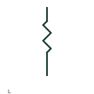

# ANSI/IEEE reactor symbol

IEEE-oriented graphical reference for reactor, with public vendor evidence and drawing-reading notes.

[Canonical reference](https://eloragrid.ai/symbols/ansi-reactor) · [Structured record](../entries/ansi-reactor.json) · [All references](README.md)

Updated: 2026-10-27. Drawing use: SLD, Schematic. Reference families: IEEE / ANSI, Manufacturer.

Graphical convention: IEEE / ANSI. Autodesk IEEE-oriented Reactors functional form.

## What it represents

The reactor form identifies an inductive component in the documented power circuit. Series or shunt connection establishes its placement, while the device schedule explains whether its intended duty concerns impedance, filtering or another application.
This is a convention-specific lookup based on the publisher's IEEE-labelled preview. The geometry here is independently drawn to explain the connection or operation; it is not a certified reproduction of the standard graphic.

## How to read it

- Trace the external connection before interpreting the inductive outline.
- Read the selected library and the project legend together. A vendor block identifier is meaningful within its named library and is not a universal standard-symbol code.

## Drawing checklist

- State circuit duty
- Record current/impedance data
- Reference equipment model

## Important distinction

A reactor's winding is not an additional transformer secondary unless magnetic coupling is explicitly part of the device.

## Facts

- Convention evidence: Autodesk IEEE Symbol Preview — Reactors
- Public vendor block name: HRT1 (Autodesk identifier; not an IEEE symbol number)
- Standards context: IEEE/ANSI 315-1975 covers diagram graphics. IEEE lists this edition as Inactive-Reserved.
- Artwork scope: Original functional illustration; exact standard glyph and compliance are not certified

## Public references

- [Autodesk IEEE Symbol Preview — Reactors](https://help.autodesk.com/cloudhelp/2021/ENU/AutoCAD-Electrical/files/GUID-2246C552-4410-48FF-9E4B-05B6460B62F7.htm) — Autodesk. Exact public IEEE-oriented category page verifying the component name and vendor block identifier.
- [IEEE/ANSI 315-1975: graphic symbols for electrical and electronics diagrams](https://standards.ieee.org/ieee/315/515/) — IEEE Standards Association. Graphic-symbol standards context and official status; not a source of reproduced artwork.

## Related references

- [Reactor](reactor.md)
- [Power transformer](power-transformer.md)
- [Capacitor](capacitor.md)

Original educational concept geometry, CC BY 4.0. Unitless; not a certified standards glyph or manufacturer footprint.

Elora-authored explanations are CC BY 4.0. Linked standards and manufacturer material retain their own rights. Confirm project requirements using primary sources.
