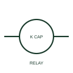

# ANSI/IEEE Relay coil with capacitor suppression form

IEEE-library form of relay coil with capacitor suppression: a relay with a capacitor suppression element includes a documented capacitive network associated with the coil.

[Canonical reference](https://eloragrid.ai/symbols/ansi-relay-coil-with-capacitor-suppression) · [Structured record](../entries/ansi-relay-coil-with-capacitor-suppression.json) · [All references](README.md)

Updated: 2026-10-28. Drawing use: Schematic. Reference families: IEEE / ANSI, Manufacturer.

Graphical convention: IEEE / ANSI. Relay with Capacitor.

## What it represents

This reference locates relay coil with capacitor suppression in Autodesk's IEEE-oriented relays with suppression family. A relay with a capacitor suppression element includes a documented capacitive network associated with the coil. Its connection and effect on switching are product-dependent. The public library uses HCR1K37 for its horizontal representation; this is a vendor block name, not an IEEE standards symbol number.
Trace the measured quantity or initiating control signal separately from the output contacts. The device tag links the sensing or operating element to the controlled circuit; settings, reset behaviour and the actual terminal arrangement belong in the selected equipment documentation.
Check the coil voltage type and suppression configuration before substituting a relay assembly. Capacitor suppression is different from the coil's operating function and from a motor run capacitor. The linked functional counterpart explains the same operating role in its own drawing context; agreement of every detailed convention mark is not asserted.

## How to read it

- Check the coil voltage type and suppression configuration before substituting a relay assembly.
- The preview is an original explanation of this function. Match the actual drawing convention to its legend and the selected equipment documentation.

## Drawing checklist

- Identify capacitor network
- State coil rating
- Reference approved suppression module

## Important distinction

Capacitor suppression is different from the coil's operating function and from a motor run capacitor.

## Facts

- Convention evidence: Autodesk IEEE Symbol Preview: Relays with Suppression; published form: Relay with Capacitor.
- Public vendor block: HCR1K37. Vendor library token, not an IEEE symbol number.
- Drawing role: Relay operation
- Identifier status: The short label is a functional lookup label, not an assigned IEC or IEEE symbol number. Any separately listed Autodesk code is a verified vendor block name.
- Artwork scope: Original educational geometry. Exact standard graphics, product ratings and terminal pinouts are not certified.

## Public references

- [Autodesk IEEE Symbol Preview — Relays with Suppression](https://help.autodesk.com/cloudhelp/2021/ENU/AutoCAD-Electrical/files/GUID-538B6A25-1215-4F1B-A824-0181D01BE721.htm) — Autodesk. Public IEEE-oriented Relays with Suppression table explicitly lists HCR1K37 as Relay with Capacitor. This supports the vendor convention context, not reproduction of the publisher graphic.

## Related references

- [Relay coil with capacitor suppression](relay-coil-with-capacitor-suppression.md)
- [Relay coil](relay-coil.md)
- [Normally open contact](normally-open-contact.md)

Original educational concept geometry, CC BY 4.0. Unitless; not a certified standards glyph or manufacturer footprint.

Elora-authored explanations are CC BY 4.0. Linked standards and manufacturer material retain their own rights. Confirm project requirements using primary sources.
