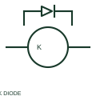

# ANSI/IEEE relay coil with diode suppression symbol

IEEE-oriented graphical reference for relay coil with diode suppression, with public vendor evidence and drawing-reading notes.

[Canonical reference](https://eloragrid.ai/symbols/ansi-relay-coil-with-diode-suppression) · [Structured record](../entries/ansi-relay-coil-with-diode-suppression.json) · [All references](README.md)

Updated: 2026-10-27. Drawing use: Schematic. Reference families: IEEE / ANSI, Manufacturer.

Graphical convention: IEEE / ANSI. Autodesk IEEE-oriented Relays with Suppression functional form.

## What it represents

The diode-suppressed relay form combines the operating element with a documented suppression component. The coil and diode connection establishes polarity requirements and can affect release behaviour, so the assembled relay or socket diagram is relevant.
This is a convention-specific lookup based on the publisher's IEEE-labelled preview. The geometry here is independently drawn to explain the connection or operation; it is not a certified reproduction of the standard graphic.

## How to read it

- Trace suppression polarity before evaluating the control supply.
- Read the selected library and the project legend together. A vendor block identifier is meaningful within its named library and is not a universal standard-symbol code.

## Drawing checklist

- Mark coil polarity
- Identify internal/external suppression
- Reference release characteristics

## Important distinction

A coil suppression diode and a rectifier in the power path serve different circuit functions.

## Facts

- Convention evidence: Autodesk IEEE Symbol Preview — Relays with Suppression
- Public vendor block name: HCR1K33 (Autodesk identifier; not an IEEE symbol number)
- Standards context: IEEE/ANSI 315-1975 covers diagram graphics. IEEE lists this edition as Inactive-Reserved.
- Artwork scope: Original functional illustration; exact standard glyph and compliance are not certified

## Public references

- [Autodesk IEEE Symbol Preview — Relays with Suppression](https://help.autodesk.com/cloudhelp/2021/ENU/AutoCAD-Electrical/files/GUID-538B6A25-1215-4F1B-A824-0181D01BE721.htm) — Autodesk. Exact public IEEE-oriented category page verifying the component name and vendor block identifier.
- [IEEE/ANSI 315-1975: graphic symbols for electrical and electronics diagrams](https://standards.ieee.org/ieee/315/515/) — IEEE Standards Association. Graphic-symbol standards context and official status; not a source of reproduced artwork.

## Related references

- [Relay coil with diode suppression](relay-coil-with-diode-suppression.md)
- [Relay coil](relay-coil.md)
- [Normally open contact](normally-open-contact.md)

Original educational concept geometry, CC BY 4.0. Unitless; not a certified standards glyph or manufacturer footprint.

Elora-authored explanations are CC BY 4.0. Linked standards and manufacturer material retain their own rights. Confirm project requirements using primary sources.
