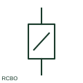

# ANSI/IEEE Residual-current breaker with overcurrent protection form

IEEE-library form of residual-current breaker with overcurrent protection: an RCBO combines residual-current operation with overcurrent protection in one device.

[Canonical reference](https://eloragrid.ai/symbols/ansi-residual-current-breaker-with-overcurrent-protection) · [Structured record](../entries/ansi-residual-current-breaker-with-overcurrent-protection.json) · [All references](README.md)

Updated: 2026-10-28. Drawing use: SLD, Schematic. Reference families: IEEE / ANSI, Manufacturer.

Graphical convention: IEEE / ANSI. Magneto/Thermal with Differential.

## What it represents

This reference locates residual-current breaker with overcurrent protection in Autodesk's IEEE-oriented 1 pole circuit breakers family. An RCBO combines residual-current operation with overcurrent protection in one device. It is often shown as a combined protective function rather than as two unrelated devices. The public library uses HCB11Q13 for its horizontal representation; this is a vendor block name, not an IEEE standards symbol number.
Use the surrounding circuit labels and the project legend to identify the intended operating condition and connection. Carry the same device reference into the schedule or equipment document so the symbol can be reconciled with its real terminals, function and operating limits.
Identify which neutral connection is switched, sensed or permanently connected for the selected model. An RCBO differs from an RCCB by its integral overcurrent protective function. The linked functional counterpart explains the same operating role in its own drawing context; agreement of every detailed convention mark is not asserted.

## How to read it

- Identify which neutral connection is switched, sensed or permanently connected for the selected model.
- The preview is an original explanation of this function. Match the actual drawing convention to its legend and the selected equipment documentation.

## Drawing checklist

- Record residual-current type
- Record overcurrent curve and rating
- Verify neutral terminal connections

## Important distinction

An RCBO differs from an RCCB by its integral overcurrent protective function.

## Facts

- Convention evidence: Autodesk IEEE Symbol Preview: 1 Pole Circuit Breakers; published form: Magneto/Thermal with Differential.
- Public vendor block: HCB11Q13. Vendor library token, not an IEEE symbol number.
- Drawing role: Circuit interruption
- Identifier status: The short label is a functional lookup label, not an assigned IEC or IEEE symbol number. Any separately listed Autodesk code is a verified vendor block name.
- Artwork scope: Original educational geometry. Exact standard graphics, product ratings and terminal pinouts are not certified.

## Public references

- [Autodesk IEEE Symbol Preview — 1 Pole Circuit Breakers](https://help.autodesk.com/cloudhelp/2021/ENU/AutoCAD-Electrical/files/GUID-7F08A484-0517-4954-BD68-1648DDBC84A1.htm) — Autodesk. Public IEEE-oriented 1 Pole Circuit Breakers table explicitly lists HCB11Q13 as Magneto/Thermal with Differential. This supports the vendor convention context, not reproduction of the publisher graphic.
- [Fundamental characteristics of a circuit-breaker](https://www.electrical-installation.org/enwiki/Fundamental_characteristics_of_a_circuit-breaker) — Schneider Electric — Electrical Installation Guide. Public documentation of this equipment function or named vendor variant; the illustration is independently authored and is not the source graphic.

## Related references

- [Residual-current breaker with overcurrent protection](residual-current-breaker-with-overcurrent-protection.md)
- [Circuit breaker](circuit-breaker.md)
- [Core-balance current transformer](core-balance-current-transformer.md)
- [Protective earth](protective-earth.md)

Original educational concept geometry, CC BY 4.0. Unitless; not a certified standards glyph or manufacturer footprint.

Elora-authored explanations are CC BY 4.0. Linked standards and manufacturer material retain their own rights. Confirm project requirements using primary sources.
