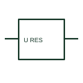

# ANSI/IEEE Residual-voltage monitoring relay form

IEEE-library form of residual-voltage monitoring relay: a residual-voltage relay responds to the specified residual-voltage measurement.

[Canonical reference](https://eloragrid.ai/symbols/ansi-residual-voltage-monitoring-relay) · [Structured record](../entries/ansi-residual-voltage-monitoring-relay.json) · [All references](README.md)

Updated: 2026-10-28. Drawing use: SLD, Schematic. Reference families: IEEE / ANSI, Manufacturer.

Graphical convention: IEEE / ANSI. Residual Voltage Protection.

## What it represents

This reference locates residual-voltage monitoring relay in Autodesk's IEEE-oriented voltage protection relays family. A residual-voltage relay responds to the specified residual-voltage measurement. Its drawing needs the voltage-transformer connection and the input quantity definition. The public library uses HCR1F38 for its horizontal representation; this is a vendor block name, not an IEEE standards symbol number.
Trace the measured quantity or initiating control signal separately from the output contacts. The device tag links the sensing or operating element to the controlled circuit; settings, reset behaviour and the actual terminal arrangement belong in the selected equipment documentation.
Check the measurement circuit that produces the residual voltage. Residual voltage is different from phase-to-neutral voltage at an arbitrary single phase. The linked functional counterpart explains the same operating role in its own drawing context; agreement of every detailed convention mark is not asserted.

## How to read it

- Check the measurement circuit that produces the residual voltage.
- The preview is an original explanation of this function. Match the actual drawing convention to its legend and the selected equipment documentation.

## Drawing checklist

- Show VT connection
- State residual input scaling
- Reference operating threshold

## Important distinction

Residual voltage is different from phase-to-neutral voltage at an arbitrary single phase.

## Facts

- Convention evidence: Autodesk IEEE Symbol Preview: Voltage Protection Relays; published form: Residual Voltage Protection.
- Public vendor block: HCR1F38. Vendor library token, not an IEEE symbol number.
- Drawing role: Monitoring element
- Identifier status: The short label is a functional lookup label, not an assigned IEC or IEEE symbol number. Any separately listed Autodesk code is a verified vendor block name.
- Artwork scope: Original educational geometry. Exact standard graphics, product ratings and terminal pinouts are not certified.

## Public references

- [Autodesk IEEE Symbol Preview: Voltage Protection Relays](https://help.autodesk.com/cloudhelp/2021/ENU/AutoCAD-Electrical/files/GUID-5D942536-ADE3-43EA-8280-CC7907C38F15.htm) — Autodesk. Public IEEE-oriented Voltage Protection Relays table explicitly lists HCR1F38 as Residual Voltage Protection. This supports the vendor convention context, not reproduction of the publisher graphic.

## Related references

- [Residual-voltage monitoring relay](residual-voltage-monitoring-relay.md)
- [Current transformer](current-transformer.md)
- [Relay coil](relay-coil.md)

Original educational concept geometry, CC BY 4.0. Unitless; not a certified standards glyph or manufacturer footprint.

Elora-authored explanations are CC BY 4.0. Linked standards and manufacturer material retain their own rights. Confirm project requirements using primary sources.
