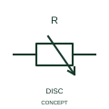

# ANSI/IEEE Resistor with disconnecting slider form

IEEE-library form of resistor with disconnecting slider: this form distinguishes a movable resistor contact with a disconnecting position.

[Canonical reference](https://eloragrid.ai/symbols/ansi-resistor-with-disconnecting-slider) · [Structured record](../entries/ansi-resistor-with-disconnecting-slider.json) · [All references](README.md)

Updated: 2026-10-28. Drawing use: Schematic. Reference families: IEEE / ANSI, Manufacturer.

Graphical convention: IEEE / ANSI. Resistor with Mobile Contact and Disconnecting Position.

## What it represents

This reference locates resistor with disconnecting slider in Autodesk's IEEE-oriented resistive components family. This form distinguishes a movable resistor contact with a disconnecting position. The movable contact can leave the resistive track at its documented disconnecting position. This changes circuit continuity as well as the selected resistance. The public library uses HVR1R5 for its horizontal representation; this is a vendor block name, not an IEEE standards symbol number.
Follow the actual current path and terminal polarity in the surrounding circuit. The symbol identifies an electrical function; voltage, current, energy limits and the device package pinout come from the selected component data rather than from the outline.
Show the track ends, slider terminal and the off-position relationship. A generic potentiometer or variable-resistor graphic can omit this important additional operating state. Show the track terminals, movable contact and the circuit condition at the off position. A disconnecting slider is different from a continuously connected potentiometer wiper. The linked functional counterpart explains the same operating role in its own drawing context; agreement of every detailed convention mark is not asserted.

## How to read it

- Show the track terminals, movable contact and the circuit condition at the off position.
- A disconnecting slider is different from a continuously connected potentiometer wiper.

## Drawing checklist

- Identify the associated device, circuit or diagram boundary.
- Show the track terminals, movable contact and the circuit condition at the off position.
- Cross-reference the equipment data, terminal mapping or operating-state legend needed to interpret the form.

## Important distinction

A disconnecting slider is different from a continuously connected potentiometer wiper.

## Facts

- Convention evidence: Autodesk IEEE Symbol Preview: Resistive Components; published form: Resistor with Mobile Contact and Disconnecting Position.
- Public vendor block: HVR1R5. Vendor library token, not an IEEE symbol number.
- Information added: Show the track terminals, movable contact and the circuit condition at the off position.
- Preview: Independent educational concept; consult the publisher and applicable standard for the exact graphic
- Artwork scope: Original educational geometry. Exact standard graphics, product ratings and terminal pinouts are not certified.

## Public references

- [Autodesk IEEE Symbol Preview — Resistive Components](https://help.autodesk.com/cloudhelp/2021/ENU/AutoCAD-Electrical/files/GUID-1A45DE3A-CD2A-4AD9-8125-219905C870B1.htm) — Autodesk. Public IEEE-oriented Resistive Components table explicitly lists HVR1R5 as Resistor with Mobile Contact and Disconnecting Position. This supports the vendor convention context, not reproduction of the publisher graphic.

## Related references

- [Resistor with disconnecting slider](iec-resistor-with-disconnecting-slider.md)
- [Resistor](resistor.md)
- [Capacitor](capacitor.md)

Original educational concept geometry, CC BY 4.0. Unitless; not a certified standards glyph or manufacturer footprint.

Elora-authored explanations are CC BY 4.0. Linked standards and manufacturer material retain their own rights. Confirm project requirements using primary sources.
