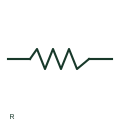

# ANSI/IEEE resistor symbol

IEEE-oriented graphical reference for resistor, with public vendor evidence and drawing-reading notes.

[Canonical reference](https://eloragrid.ai/symbols/ansi-resistor) · [Structured record](../entries/ansi-resistor.json) · [All references](README.md)

Updated: 2026-10-27. Drawing use: Schematic. Reference families: IEEE / ANSI, Manufacturer.

Graphical convention: IEEE / ANSI. Autodesk IEEE-oriented Resistive Components functional form.

## What it represents

The fixed-resistor form identifies resistance in the circuit path. This original zigzag illustration explains the resistive function without assigning a standard graphic number; the component value, power rating and reference designator remain essential to reading the actual schematic.
This is a convention-specific lookup based on the publisher's IEEE-labelled preview. The geometry here is independently drawn to explain the connection or operation; it is not a certified reproduction of the standard graphic.

## How to read it

- Read resistance and rating from the annotation rather than from the number of drawn zigzag segments.
- Read the selected library and the project legend together. A vendor block identifier is meaningful within its named library and is not a universal standard-symbol code.

## Drawing checklist

- State resistance/tolerance
- Record power rating
- Identify circuit function

## Important distinction

A fixed resistance and a variable resistance are different component functions, even if their basic graphical family is related.

## Facts

- Convention evidence: Autodesk IEEE Symbol Preview — Resistive Components
- Public vendor block name: HRE1B (Autodesk identifier; not an IEEE symbol number)
- Standards context: IEEE/ANSI 315-1975 covers diagram graphics. IEEE lists this edition as Inactive-Reserved.
- Artwork scope: Original functional illustration; exact standard glyph and compliance are not certified

## Public references

- [Autodesk IEEE Symbol Preview — Resistive Components](https://help.autodesk.com/cloudhelp/2021/ENU/AutoCAD-Electrical/files/GUID-1A45DE3A-CD2A-4AD9-8125-219905C870B1.htm) — Autodesk. Exact public IEEE-oriented category page verifying the component name and vendor block identifier.
- [IEEE/ANSI 315-1975: graphic symbols for electrical and electronics diagrams](https://standards.ieee.org/ieee/315/515/) — IEEE Standards Association. Graphic-symbol standards context and official status; not a source of reproduced artwork.

## Related references

- [Resistor](resistor.md)
- [Capacitor](capacitor.md)
- [Relay coil](relay-coil.md)
- [Terminal connection](terminal.md)

Original educational concept geometry, CC BY 4.0. Unitless; not a certified standards glyph or manufacturer footprint.

Elora-authored explanations are CC BY 4.0. Linked standards and manufacturer material retain their own rights. Confirm project requirements using primary sources.
