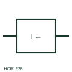

# ANSI/IEEE Reverse-current measuring relay form

IEEE-library form of reverse-current measuring relay: measuring relay that operates when current flows in the opposite direction to normal, such as back-feed into a DC source.

[Canonical reference](https://eloragrid.ai/symbols/ansi-reverse-current-relay) · [Structured record](../entries/ansi-reverse-current-relay.json) · [All references](README.md)

Updated: 2026-10-28. Drawing use: Schematic, SLD. Reference families: IEEE / ANSI, Manufacturer.

Graphical convention: IEEE / ANSI. Come Back Current Protection.

## What it represents

This reference locates reverse-current measuring relay in Autodesk's IEEE-oriented current protection relays family. A reverse-current relay compares the direction of current with a reference and operates when current flows the wrong way. Classic uses are DC generators and battery chargers in parallel, where a failed source would otherwise draw current from the bus, and rectifier feeders where back-feed indicates a fault. The public library uses HCR1F28 for its horizontal representation; this is a vendor block name, not an IEEE standards symbol number.
Trace the measured quantity or initiating control signal separately from the output contacts. The device tag links the sensing or operating element to the controlled circuit; settings, reset behaviour and the actual terminal arrangement belong in the selected equipment documentation.
On the schematic the relay box carries a current quantity with a direction qualifier, and its contacts are drawn elsewhere in the trip or alarm circuit. The box does not show the pick-up level or time delay, and in AC systems the equivalent requirement is usually met with a directional power function rather than a simple current-direction element. Identify which direction is treated as normal for the source. A reverse-current relay responds to current direction; a maximum-current relay responds to magnitude regardless of direction. The linked functional counterpart explains the same operating role in its own drawing context; agreement of every detailed convention mark is not asserted.

## How to read it

- Identify which direction is treated as normal for the source.
- Find the contacts that trip or disconnect the source.

## Drawing checklist

- State normal current direction
- Give pick-up and delay
- Reference the trip contact

## Important distinction

A reverse-current relay responds to current direction; a maximum-current relay responds to magnitude regardless of direction.

## Facts

- Convention evidence: Autodesk IEEE Symbol Preview: Current Protection Relays; published form: Come Back Current Protection.
- Public vendor block: HCR1F28. Vendor library token, not an IEEE symbol number.
- Measured quantity: Current direction relative to normal flow
- Preview: Independent educational concept; consult the publisher and applicable standard for the exact graphic
- Artwork scope: Original educational geometry. Exact standard graphics, product ratings and terminal pinouts are not certified.

## Public references

- [Autodesk IEEE Symbol Preview: Current Protection Relays](https://help.autodesk.com/cloudhelp/2021/ENU/AutoCAD-Electrical/files/GUID-EC11EC4D-374C-4191-9534-C802D3932711.htm) — Autodesk. Public IEEE-oriented Current Protection Relays table explicitly lists HCR1F28 as Come Back Current Protection. This supports the vendor convention context, not reproduction of the publisher graphic.
- [IEC graphical symbols for diagrams](https://tc3.iec.ch/tc-activity/graphical-symbols-for-diagrams/) — IEC. IEC context for graphical symbols used in diagrams; no IEC graphic is reproduced.

## Related references

- [Reverse-current measuring relay](reverse-current-relay.md)
- [Maximum-current monitoring relay](maximum-current-monitoring-relay.md)
- [Directional power](32-directional-power.md)
- [Directional measuring element qualifier](directional-measuring-element-qualifier.md)

Original educational concept geometry, CC BY 4.0. Unitless; not a certified standards glyph or manufacturer footprint.

Elora-authored explanations are CC BY 4.0. Linked standards and manufacturer material retain their own rights. Confirm project requirements using primary sources.
