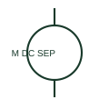

# ANSI/IEEE Separately excited DC motor form

IEEE-library form of separately excited dc motor: a separately excited DC motor has a documented field circuit supplied separately from the armature circuit.

[Canonical reference](https://eloragrid.ai/symbols/ansi-separately-excited-dc-motor) · [Structured record](../entries/ansi-separately-excited-dc-motor.json) · [All references](README.md)

Updated: 2026-10-28. Drawing use: SLD, Schematic. Reference families: IEEE / ANSI, Manufacturer.

Graphical convention: IEEE / ANSI. DC Motor - Independent Excitation.

## What it represents

This reference locates separately excited dc motor in Autodesk's IEEE-oriented dc motors family. A separately excited DC motor has a documented field circuit supplied separately from the armature circuit. The schematic must show both supplies and their relevant controls. The public library uses HMO1M12 for its horizontal representation; this is a vendor block name, not an IEEE standards symbol number.
Trace each winding, supply and accessible neutral through the complete machine or transformer connection diagram. Keep the phase arrangement, terminal labels and any clock notation attached to the device; neither the convention label nor this educational outline supplies its ratings.
Trace the field source independently from armature power. Separately excited and series-excited motors do not share the same field-current path. The linked functional counterpart explains the same operating role in its own drawing context; agreement of every detailed convention mark is not asserted.

## How to read it

- Trace the field source independently from armature power.
- The preview is an original explanation of this function. Match the actual drawing convention to its legend and the selected equipment documentation.

## Drawing checklist

- Identify field supply
- Identify armature supply
- Reference coordinated control sequence

## Important distinction

Separately excited and series-excited motors do not share the same field-current path.

## Facts

- Convention evidence: Autodesk IEEE Symbol Preview: DC Motors; published form: DC Motor - Independent Excitation.
- Public vendor block: HMO1M12. Vendor library token, not an IEEE symbol number.
- Drawing role: Rotating or linear load
- Identifier status: The short label is a functional lookup label, not an assigned IEC or IEEE symbol number. Any separately listed Autodesk code is a verified vendor block name.
- Artwork scope: Original educational geometry. Exact standard graphics, product ratings and terminal pinouts are not certified.

## Public references

- [Autodesk IEEE Symbol Preview — DC Motors](https://help.autodesk.com/cloudhelp/2021/ENU/AutoCAD-Electrical/files/GUID-6A65D995-18BC-4A3C-A34E-C6BB276E8410.htm) — Autodesk. Public IEEE-oriented DC Motors table explicitly lists HMO1M12 as DC Motor - Independent Excitation. This supports the vendor convention context, not reproduction of the publisher graphic.

## Related references

- [Separately excited DC motor](separately-excited-dc-motor.md)
- [Three-phase motor](motor.md)
- [Contactor](contactor.md)

Original educational concept geometry, CC BY 4.0. Unitless; not a certified standards glyph or manufacturer footprint.

Elora-authored explanations are CC BY 4.0. Linked standards and manufacturer material retain their own rights. Confirm project requirements using primary sources.
