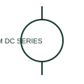

# ANSI/IEEE Series-excited DC motor form

IEEE-library form of series-excited dc motor: a series-excited DC motor connects its documented field winding in series with the armature circuit.

[Canonical reference](https://eloragrid.ai/symbols/ansi-series-excited-dc-motor) · [Structured record](../entries/ansi-series-excited-dc-motor.json) · [All references](README.md)

Updated: 2026-10-28. Drawing use: SLD, Schematic. Reference families: IEEE / ANSI, Manufacturer.

Graphical convention: IEEE / ANSI. DC Motor - Series Excitation.

## What it represents

This reference locates series-excited dc motor in Autodesk's IEEE-oriented dc motors family. A series-excited DC motor connects its documented field winding in series with the armature circuit. Both winding and armature terminals need to remain identifiable in expanded schematics. The public library uses HMO1M7 for its horizontal representation; this is a vendor block name, not an IEEE standards symbol number.
Trace each winding, supply and accessible neutral through the complete machine or transformer connection diagram. Keep the phase arrangement, terminal labels and any clock notation attached to the device; neither the convention label nor this educational outline supplies its ratings.
Follow the field current through the armature path. A series field and a shunt field have different circuit connections. The linked functional counterpart explains the same operating role in its own drawing context; agreement of every detailed convention mark is not asserted.

## How to read it

- Follow the field current through the armature path.
- The preview is an original explanation of this function. Match the actual drawing convention to its legend and the selected equipment documentation.

## Drawing checklist

- Show series field connection
- Identify armature terminals
- Reference starting/control arrangement

## Important distinction

A series field and a shunt field have different circuit connections.

## Facts

- Convention evidence: Autodesk IEEE Symbol Preview: DC Motors; published form: DC Motor - Series Excitation.
- Public vendor block: HMO1M7. Vendor library token, not an IEEE symbol number.
- Drawing role: Rotating or linear load
- Identifier status: The short label is a functional lookup label, not an assigned IEC or IEEE symbol number. Any separately listed Autodesk code is a verified vendor block name.
- Artwork scope: Original educational geometry. Exact standard graphics, product ratings and terminal pinouts are not certified.

## Public references

- [Autodesk IEEE Symbol Preview — DC Motors](https://help.autodesk.com/cloudhelp/2021/ENU/AutoCAD-Electrical/files/GUID-6A65D995-18BC-4A3C-A34E-C6BB276E8410.htm) — Autodesk. Public IEEE-oriented DC Motors table explicitly lists HMO1M7 as DC Motor - Series Excitation. This supports the vendor convention context, not reproduction of the publisher graphic.

## Related references

- [Series-excited DC motor](series-excited-dc-motor.md)
- [Three-phase motor](motor.md)
- [Contactor](contactor.md)

Original educational concept geometry, CC BY 4.0. Unitless; not a certified standards glyph or manufacturer footprint.

Elora-authored explanations are CC BY 4.0. Linked standards and manufacturer material retain their own rights. Confirm project requirements using primary sources.
