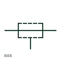

# ANSI/IEEE shielded conductor symbol

IEEE-oriented shielded conductor drawn with a dashed or broken outline around the wire to show a shield.

[Canonical reference](https://eloragrid.ai/symbols/ansi-shielded-conductor) · [Structured record](../entries/ansi-shielded-conductor.json) · [All references](README.md)

Updated: 2026-10-28. Drawing use: Schematic. Reference families: IEEE / ANSI.

Graphical convention: IEEE / ANSI. Shielded conductor with broken enclosure.

## What it represents

In IEEE-oriented drawings a shielded conductor is commonly shown with a broken or dashed enclosure around the conductor, sometimes with a short lead to a ground symbol. US instrumentation drawings use it for analogue signal wiring, thermocouple extension leads and drive feedback.
This is an independently drawn explanation of the convention, not a reproduction of the IEEE graphic. As with the IEC form, the outline does not say where the shield is grounded, which must be shown at the shield lead. Shield drain wires should have their own terminal numbers.

## How to read it

- Locate the shield drain termination.
- Check whether the shield is grounded at one end only.

## Drawing checklist

- Show the shield ground point.
- Assign terminal numbers to drain wires.
- Record shield type in the cable schedule.

## Important distinction

A shielded conductor intercepts interference; a coaxial cable uses its outer conductor as the signal return.

## Facts

- Convention evidence: IEEE 315 graphic conventions for shielded conductors (standards context only)
- Standards context: IEEE/ANSI 315-1975 covers diagram graphics; IEEE lists this edition as Inactive-Reserved.
- Preview: Original educational illustration; consult the publisher and applicable standard for the exact graphic

## Public references

- [IEEE/ANSI 315-1975: graphic symbols for electrical and electronics diagrams](https://standards.ieee.org/ieee/315/515/) — IEEE Standards Association. Graphic-symbol standards context and official status; not a source of reproduced artwork.
- [Autodesk IEEE Symbol Preview — Miscellaneous](https://help.autodesk.com/cloudhelp/2021/ENU/AutoCAD-Electrical/files/GUID-34282BFD-7B8E-48F3-A6ED-93ADBDDDFBD3.htm) — Autodesk. Public IEEE-oriented earth forms used on shield drains.

## Related references

- [Screened conductor](iec-screened-conductor.md)
- [ANSI/IEEE coaxial cable symbol](ansi-coaxial-cable.md)
- [ANSI/IEEE functional earth symbol](ansi-functional-earth.md)

Original educational concept geometry, CC BY 4.0. Unitless; not a certified standards glyph or manufacturer footprint.

Elora-authored explanations are CC BY 4.0. Linked standards and manufacturer material retain their own rights. Confirm project requirements using primary sources.
