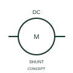

# ANSI/IEEE Shunt-excited DC motor form

IEEE-library form of shunt-excited dc motor: this representation distinguishes the publisher's derived or shunt-excitation DC motor form.

[Canonical reference](https://eloragrid.ai/symbols/ansi-shunt-excited-dc-motor) · [Structured record](../entries/ansi-shunt-excited-dc-motor.json) · [All references](README.md)

Updated: 2026-10-28. Drawing use: SLD, Schematic. Reference families: IEEE / ANSI, Manufacturer.

Graphical convention: IEEE / ANSI. DC Motor - Derived Excitation.

## What it represents

This reference locates shunt-excited dc motor in Autodesk's IEEE-oriented dc motors family. This representation distinguishes the publisher's derived or shunt-excitation DC motor form. The public library uses HMO1M8 for its horizontal representation; this is a vendor block name, not an IEEE standards symbol number.
Trace each winding, supply and accessible neutral through the complete machine or transformer connection diagram. Keep the phase arrangement, terminal labels and any clock notation attached to the device; neither the convention label nor this educational outline supplies its ratings.
Document the field connection separately from the armature circuit. Shunt, series and separately supplied field arrangements are different connection topologies. Document the field connection separately from the armature circuit. Shunt, series and separately supplied field arrangements are different connection topologies. The linked functional counterpart explains the same operating role in its own drawing context; agreement of every detailed convention mark is not asserted.

## How to read it

- Document the field connection separately from the armature circuit.
- Shunt, series and separately supplied field arrangements are different connection topologies.

## Drawing checklist

- Identify the associated device, circuit or diagram boundary.
- Document the field connection separately from the armature circuit.
- Cross-reference the equipment data, terminal mapping or operating-state legend needed to interpret the form.

## Important distinction

Shunt, series and separately supplied field arrangements are different connection topologies.

## Facts

- Convention evidence: Autodesk IEEE Symbol Preview: DC Motors; published form: DC Motor - Derived Excitation.
- Public vendor block: HMO1M8. Vendor library token, not an IEEE symbol number.
- Information added: Document the field connection separately from the armature circuit.
- Preview: Independent educational concept; consult the publisher and applicable standard for the exact graphic
- Artwork scope: Original educational geometry. Exact standard graphics, product ratings and terminal pinouts are not certified.

## Public references

- [Autodesk IEEE Symbol Preview — DC Motors](https://help.autodesk.com/cloudhelp/2021/ENU/AutoCAD-Electrical/files/GUID-6A65D995-18BC-4A3C-A34E-C6BB276E8410.htm) — Autodesk. Public IEEE-oriented DC Motors table explicitly lists HMO1M8 as DC Motor - Derived Excitation. This supports the vendor convention context, not reproduction of the publisher graphic.

## Related references

- [Shunt-excited DC motor](iec-shunt-excited-dc-motor.md)
- [Three-phase motor](motor.md)
- [Generator](generator.md)

Original educational concept geometry, CC BY 4.0. Unitless; not a certified standards glyph or manufacturer footprint.

Elora-authored explanations are CC BY 4.0. Linked standards and manufacturer material retain their own rights. Confirm project requirements using primary sources.
