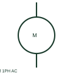

# ANSI/IEEE single-phase ac motor symbol

IEEE-oriented graphical reference for single-phase ac motor, with public vendor evidence and drawing-reading notes.

[Canonical reference](https://eloragrid.ai/symbols/ansi-single-phase-ac-motor) · [Structured record](../entries/ansi-single-phase-ac-motor.json) · [All references](README.md)

Updated: 2026-10-27. Drawing use: SLD, Schematic. Reference families: IEEE / ANSI, Manufacturer.

Graphical convention: IEEE / ANSI. Autodesk IEEE-oriented 1 Phase Motors functional form.

## What it represents

The single-phase AC motor form identifies a documented electrical load with a specified single-phase supply. Winding terminals, start/run components and mechanical driven duty require the actual motor data beyond the simplified machine circle.
This is a convention-specific lookup based on the publisher's IEEE-labelled preview. The geometry here is independently drawn to explain the connection or operation; it is not a certified reproduction of the standard graphic.

## How to read it

- Locate the selected motor connection diagram before wiring auxiliary components.
- Read the selected library and the project legend together. A vendor block identifier is meaningful within its named library and is not a universal standard-symbol code.

## Drawing checklist

- State voltage/power
- Reference winding terminals
- Show starting and protection circuits

## Important distinction

A single-phase motor form does not select a universal capacitor or starting arrangement.

## Facts

- Convention evidence: Autodesk IEEE Symbol Preview — 1 Phase Motors
- Public vendor block name: HMO1M9 (Autodesk identifier; not an IEEE symbol number)
- Standards context: IEEE/ANSI 315-1975 covers diagram graphics. IEEE lists this edition as Inactive-Reserved.
- Artwork scope: Original functional illustration; exact standard glyph and compliance are not certified

## Public references

- [Autodesk IEEE Symbol Preview — 1 Phase Motors](https://help.autodesk.com/cloudhelp/2021/ENU/AutoCAD-Electrical/files/GUID-B12EF00E-CBDF-4043-9264-8F7D07E107D6.htm) — Autodesk. Exact public IEEE-oriented category page verifying the component name and vendor block identifier.
- [IEEE/ANSI 315-1975: graphic symbols for electrical and electronics diagrams](https://standards.ieee.org/ieee/315/515/) — IEEE Standards Association. Graphic-symbol standards context and official status; not a source of reproduced artwork.

## Related references

- [Single-phase AC motor](single-phase-ac-motor.md)
- [Three-phase motor](motor.md)
- [Contactor](contactor.md)

Original educational concept geometry, CC BY 4.0. Unitless; not a certified standards glyph or manufacturer footprint.

Elora-authored explanations are CC BY 4.0. Linked standards and manufacturer material retain their own rights. Confirm project requirements using primary sources.
