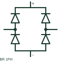

# ANSI/IEEE single-phase bridge rectifier symbol

IEEE-oriented graphical reference for single-phase bridge rectifier, with public vendor evidence and drawing-reading notes.

[Canonical reference](https://eloragrid.ai/symbols/ansi-single-phase-bridge-rectifier) · [Structured record](../entries/ansi-single-phase-bridge-rectifier.json) · [All references](README.md)

Updated: 2026-10-27. Drawing use: Schematic. Reference families: IEEE / ANSI, Manufacturer.

Graphical convention: IEEE / ANSI. Autodesk IEEE-oriented Semiconductor Components functional form.

## What it represents

The bridge-rectifier form identifies a multi-junction AC-to-DC arrangement with separate AC inputs and polarised DC output. This original four-branch diagram illustrates the connection principle; rectifier rating and any smoothing or regulation remain separate specifications.
This is a convention-specific lookup based on the publisher's IEEE-labelled preview. The geometry here is independently drawn to explain the connection or operation; it is not a certified reproduction of the standard graphic.

## How to read it

- Trace both AC inputs and both DC outputs.
- Read the selected library and the project legend together. A vendor block identifier is meaningful within its named library and is not a universal standard-symbol code.

## Drawing checklist

- Identify AC terminal pair
- Mark DC polarity
- Reference bridge ratings

## Important distinction

A rectifier bridge supplies rectified output; it is not automatically a regulated DC power supply.

## Facts

- Convention evidence: Autodesk IEEE Symbol Preview — Semiconductor Components
- Public vendor block name: HDI1BR (Autodesk identifier; not an IEEE symbol number)
- Standards context: IEEE/ANSI 315-1975 covers diagram graphics. IEEE lists this edition as Inactive-Reserved.
- Artwork scope: Original functional illustration; exact standard glyph and compliance are not certified

## Public references

- [Autodesk IEEE Symbol Preview — Semiconductor Components](https://help.autodesk.com/cloudhelp/2021/ENU/AutoCAD-Electrical/files/GUID-EC01CFC2-47B9-4AE3-AE5E-0FB86D327A82.htm) — Autodesk. Exact public IEEE-oriented category page verifying the component name and vendor block identifier.
- [IEEE/ANSI 315-1975: graphic symbols for electrical and electronics diagrams](https://standards.ieee.org/ieee/315/515/) — IEEE Standards Association. Graphic-symbol standards context and official status; not a source of reproduced artwork.

## Related references

- [Single-phase bridge rectifier](single-phase-bridge-rectifier.md)
- [Diode](diode.md)
- [AC-to-DC power supply](ac-to-dc-power-supply.md)
- [Power converter / inverter](power-converter.md)

Original educational concept geometry, CC BY 4.0. Unitless; not a certified standards glyph or manufacturer footprint.

Elora-authored explanations are CC BY 4.0. Linked standards and manufacturer material retain their own rights. Confirm project requirements using primary sources.
