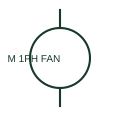

# ANSI/IEEE Single-phase motor with fan form

IEEE-library form of single-phase motor with fan: a single-phase motor with an associated fan identifies the driven function as well as the electrical load.

[Canonical reference](https://eloragrid.ai/symbols/ansi-single-phase-motor-with-fan) · [Structured record](../entries/ansi-single-phase-motor-with-fan.json) · [All references](README.md)

Updated: 2026-10-28. Drawing use: SLD, Schematic. Reference families: IEEE / ANSI, Manufacturer.

Graphical convention: IEEE / ANSI. 1 Phase Motor with Fan.

## What it represents

This reference locates single-phase motor with fan in Autodesk's IEEE-oriented 1 phase motors family. A single-phase motor with an associated fan identifies the driven function as well as the electrical load. Its schematic supply is separate from the airflow or installation detail. The public library uses HMO1M3M for its horizontal representation; this is a vendor block name, not an IEEE standards symbol number.
Trace each winding, supply and accessible neutral through the complete machine or transformer connection diagram. Keep the phase arrangement, terminal labels and any clock notation attached to the device; neither the convention label nor this educational outline supplies its ratings.
Link the motor tag to the cabinet or auxiliary fan shown on the layout. A fan annotation identifies driven equipment, not a new electrical phase system. The linked functional counterpart explains the same operating role in its own drawing context; agreement of every detailed convention mark is not asserted.

## How to read it

- Link the motor tag to the cabinet or auxiliary fan shown on the layout.
- The preview is an original explanation of this function. Match the actual drawing convention to its legend and the selected equipment documentation.

## Drawing checklist

- Name fan/motor tag
- State electrical rating
- Reference airflow and installation data

## Important distinction

A fan annotation identifies driven equipment, not a new electrical phase system.

## Facts

- Convention evidence: Autodesk IEEE Symbol Preview: 1 Phase Motors; published form: 1 Phase Motor with Fan.
- Public vendor block: HMO1M3M. Vendor library token, not an IEEE symbol number.
- Drawing role: Rotating or linear load
- Identifier status: The short label is a functional lookup label, not an assigned IEC or IEEE symbol number. Any separately listed Autodesk code is a verified vendor block name.
- Artwork scope: Original educational geometry. Exact standard graphics, product ratings and terminal pinouts are not certified.

## Public references

- [Autodesk IEEE Symbol Preview — 1 Phase Motors](https://help.autodesk.com/cloudhelp/2021/ENU/AutoCAD-Electrical/files/GUID-B12EF00E-CBDF-4043-9264-8F7D07E107D6.htm) — Autodesk. Public IEEE-oriented 1 Phase Motors table explicitly lists HMO1M3M as 1 Phase Motor with Fan. This supports the vendor convention context, not reproduction of the publisher graphic.

## Related references

- [Single-phase motor with fan](single-phase-motor-with-fan.md)
- [Three-phase motor](motor.md)
- [Contactor](contactor.md)

Original educational concept geometry, CC BY 4.0. Unitless; not a certified standards glyph or manufacturer footprint.

Elora-authored explanations are CC BY 4.0. Linked standards and manufacturer material retain their own rights. Confirm project requirements using primary sources.
