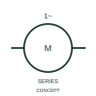

# ANSI/IEEE Single-phase series-connected AC motor form

IEEE-library form of single-phase series-connected ac motor: this representation distinguishes the publisher's single-phase AC motor with series connection.

[Canonical reference](https://eloragrid.ai/symbols/ansi-single-phase-series-connected-ac-motor) · [Structured record](../entries/ansi-single-phase-series-connected-ac-motor.json) · [All references](README.md)

Updated: 2026-10-28. Drawing use: SLD, Schematic. Reference families: IEEE / ANSI, Manufacturer.

Graphical convention: IEEE / ANSI. 1 Phase AC Motor in Series Connection.

## What it represents

This reference locates single-phase series-connected ac motor in Autodesk's IEEE-oriented 1 phase motors family. This representation distinguishes the publisher's single-phase AC motor with series connection. The public library uses HMO1M10 for its horizontal representation; this is a vendor block name, not an IEEE standards symbol number.
Trace each winding, supply and accessible neutral through the complete machine or transformer connection diagram. Keep the phase arrangement, terminal labels and any clock notation attached to the device; neither the convention label nor this educational outline supplies its ratings.
Document the actual field/armature or winding connection from the selected machine. Single-phase supply character does not establish an ordinary induction-motor winding arrangement. Document the actual field/armature or winding connection from the selected machine. Single-phase supply character does not establish an ordinary induction-motor winding arrangement. The linked functional counterpart explains the same operating role in its own drawing context; agreement of every detailed convention mark is not asserted.

## How to read it

- Document the actual field/armature or winding connection from the selected machine.
- Single-phase supply character does not establish an ordinary induction-motor winding arrangement.

## Drawing checklist

- Identify the associated device, circuit or diagram boundary.
- Document the actual field/armature or winding connection from the selected machine.
- Cross-reference the equipment data, terminal mapping or operating-state legend needed to interpret the form.

## Important distinction

Single-phase supply character does not establish an ordinary induction-motor winding arrangement.

## Facts

- Convention evidence: Autodesk IEEE Symbol Preview: 1 Phase Motors; published form: 1 Phase AC Motor in Series Connection.
- Public vendor block: HMO1M10. Vendor library token, not an IEEE symbol number.
- Information added: Document the actual field/armature or winding connection from the selected machine.
- Preview: Independent educational concept; consult the publisher and applicable standard for the exact graphic
- Artwork scope: Original educational geometry. Exact standard graphics, product ratings and terminal pinouts are not certified.

## Public references

- [Autodesk IEEE Symbol Preview — 1 Phase Motors](https://help.autodesk.com/cloudhelp/2021/ENU/AutoCAD-Electrical/files/GUID-B12EF00E-CBDF-4043-9264-8F7D07E107D6.htm) — Autodesk. Public IEEE-oriented 1 Phase Motors table explicitly lists HMO1M10 as 1 Phase AC Motor in Series Connection. This supports the vendor convention context, not reproduction of the publisher graphic.

## Related references

- [Single-phase series-connected AC motor](iec-single-phase-series-connected-ac-motor.md)
- [Three-phase motor](motor.md)
- [Generator](generator.md)

Original educational concept geometry, CC BY 4.0. Unitless; not a certified standards glyph or manufacturer footprint.

Elora-authored explanations are CC BY 4.0. Linked standards and manufacturer material retain their own rights. Confirm project requirements using primary sources.
