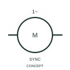

# ANSI/IEEE Single-phase synchronous motor form

IEEE-library form of single-phase synchronous motor: this representation identifies a single-phase synchronous machine function.

[Canonical reference](https://eloragrid.ai/symbols/ansi-single-phase-synchronous-motor) · [Structured record](../entries/ansi-single-phase-synchronous-motor.json) · [All references](README.md)

Updated: 2026-10-28. Drawing use: SLD, Schematic. Reference families: IEEE / ANSI, Manufacturer.

Graphical convention: IEEE / ANSI. 1 Phase Synchronous AC Motor.

## What it represents

This reference locates single-phase synchronous motor in Autodesk's IEEE-oriented 1 phase motors family. This representation identifies a single-phase synchronous machine function. The public library uses HMO1M16 for its horizontal representation; this is a vendor block name, not an IEEE standards symbol number.
Trace each winding, supply and accessible neutral through the complete machine or transformer connection diagram. Keep the phase arrangement, terminal labels and any clock notation attached to the device; neither the convention label nor this educational outline supplies its ratings.
State the supply, starting and any excitation interface required by the actual motor. Synchronous operation differs from induction-motor operating slip. State the supply, starting and any excitation interface required by the actual motor. Synchronous operation differs from induction-motor operating slip. The linked functional counterpart explains the same operating role in its own drawing context; agreement of every detailed convention mark is not asserted.

## How to read it

- State the supply, starting and any excitation interface required by the actual motor.
- Synchronous operation differs from induction-motor operating slip.

## Drawing checklist

- Identify the associated device, circuit or diagram boundary.
- State the supply, starting and any excitation interface required by the actual motor.
- Cross-reference the equipment data, terminal mapping or operating-state legend needed to interpret the form.

## Important distinction

Synchronous operation differs from induction-motor operating slip.

## Facts

- Convention evidence: Autodesk IEEE Symbol Preview: 1 Phase Motors; published form: 1 Phase Synchronous AC Motor.
- Public vendor block: HMO1M16. Vendor library token, not an IEEE symbol number.
- Information added: State the supply, starting and any excitation interface required by the actual motor.
- Preview: Independent educational concept; consult the publisher and applicable standard for the exact graphic
- Artwork scope: Original educational geometry. Exact standard graphics, product ratings and terminal pinouts are not certified.

## Public references

- [Autodesk IEEE Symbol Preview — 1 Phase Motors](https://help.autodesk.com/cloudhelp/2021/ENU/AutoCAD-Electrical/files/GUID-B12EF00E-CBDF-4043-9264-8F7D07E107D6.htm) — Autodesk. Public IEEE-oriented 1 Phase Motors table explicitly lists HMO1M16 as 1 Phase Synchronous AC Motor. This supports the vendor convention context, not reproduction of the publisher graphic.

## Related references

- [Single-phase synchronous motor](iec-single-phase-synchronous-motor.md)
- [Three-phase motor](motor.md)
- [Generator](generator.md)

Original educational concept geometry, CC BY 4.0. Unitless; not a certified standards glyph or manufacturer footprint.

Elora-authored explanations are CC BY 4.0. Linked standards and manufacturer material retain their own rights. Confirm project requirements using primary sources.
