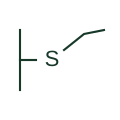

# ANSI single-pole switch plan symbol

US-style plan symbol for a single-pole wall switch: the letter S at the switch position with a switch leg to the lights.

[Canonical reference](https://eloragrid.ai/symbols/ansi-single-pole-switch) · [Structured record](../entries/ansi-single-pole-switch.json) · [All references](README.md)

Updated: 2026-10-28. Drawing use: GA. Reference families: IEEE / ANSI.

Graphical convention: IEEE / ANSI. Single-pole switch, S.

## What it represents

US architectural electrical plans mark a single-pole wall switch with the letter S beside the wall, usually with a short line to the wall. A curved dashed switch leg runs to the controlled lighting outlets, and lowercase letters can tie a switch to specific fixtures.
Subscripts modify the S: S3 for three-way, S4 for four-way, SD for dimmer, SK for key-operated and so on. The plain S therefore means a basic single-pole switch. The S does not say rating, colour or device style, which are specified separately.

## How to read it

- Check for subscripts that change the type.
- Follow switch legs or lowercase letters to the controlled fixtures.

## Drawing checklist

- Draw switch legs or letter keys to fixtures.
- Use subscripts for special types.
- State mounting height in general notes.

## Important distinction

The IEC one-way switch is drawn as a circle with a stroke; the US form is the letter S.

## Facts

- Graphic form: Letter S at the wall
- Modifiers: Subscripts such as 3, 4, D, K, P
- Artwork scope: Original educational illustration; the exact ANSI or IEEE graphic and compliance are not certified

## Public references

- [IEEE/ANSI 315-1975: graphic symbols for electrical and electronics diagrams](https://standards.ieee.org/ieee/315/515/) — IEEE Standards Association. Graphic-symbol standards context and official status; not a source of reproduced artwork.

## Related references

- [One-way light switch plan mark](iec-one-way-light-switch.md)
- [ANSI three-way switch plan symbol](ansi-three-way-switch.md)
- [ANSI dimmer switch plan symbol](ansi-dimmer-switch.md)

Original educational concept geometry, CC BY 4.0. Unitless; not a certified standards glyph or manufacturer footprint.

Elora-authored explanations are CC BY 4.0. Linked standards and manufacturer material retain their own rights. Confirm project requirements using primary sources.
