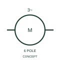

# ANSI/IEEE Six-pole asynchronous motor form

IEEE-library form of six-pole asynchronous motor: this form identifies the publisher's six-pole asynchronous motor representation.

[Canonical reference](https://eloragrid.ai/symbols/ansi-six-pole-asynchronous-motor) · [Structured record](../entries/ansi-six-pole-asynchronous-motor.json) · [All references](README.md)

Updated: 2026-10-28. Drawing use: SLD, Schematic. Reference families: IEEE / ANSI, Manufacturer.

Graphical convention: IEEE / ANSI. 3 Phase Asynchro Motor - 6 Pole.

## What it represents

This reference locates six-pole asynchronous motor in Autodesk's IEEE-oriented 3 phase motors family. This form identifies the publisher's six-pole asynchronous motor representation. The public library uses HMO1M11 for its horizontal representation; this is a vendor block name, not an IEEE standards symbol number.
Trace each winding, supply and accessible neutral through the complete machine or transformer connection diagram. Keep the phase arrangement, terminal labels and any clock notation attached to the device; neither the convention label nor this educational outline supplies its ratings.
Record the pole count and the selected supply/control interface in the schedule. Six poles describe magnetic machine construction, not six electrical phases. Record the pole count and the selected supply/control interface in the schedule. Six poles describe magnetic machine construction, not six electrical phases. The linked functional counterpart explains the same operating role in its own drawing context; agreement of every detailed convention mark is not asserted.

## How to read it

- Record the pole count and the selected supply/control interface in the schedule.
- Six poles describe magnetic machine construction, not six electrical phases.

## Drawing checklist

- Identify the associated device, circuit or diagram boundary.
- Record the pole count and the selected supply/control interface in the schedule.
- Cross-reference the equipment data, terminal mapping or operating-state legend needed to interpret the form.

## Important distinction

Six poles describe magnetic machine construction, not six electrical phases.

## Facts

- Convention evidence: Autodesk IEEE Symbol Preview: 3 Phase Motors; published form: 3 Phase Asynchro Motor - 6 Pole.
- Public vendor block: HMO1M11. Vendor library token, not an IEEE symbol number.
- Information added: Record the pole count and the selected supply/control interface in the schedule.
- Preview: Independent educational concept; consult the publisher and applicable standard for the exact graphic
- Artwork scope: Original educational geometry. Exact standard graphics, product ratings and terminal pinouts are not certified.

## Public references

- [Autodesk IEEE Symbol Preview — 3 Phase Motors](https://help.autodesk.com/cloudhelp/2021/ENU/AutoCAD-Electrical/files/GUID-392101FD-A88C-4BAC-96CD-1C676094C262.htm) — Autodesk. Public IEEE-oriented 3 Phase Motors table explicitly lists HMO1M11 as 3 Phase Asynchro Motor - 6 Pole. This supports the vendor convention context, not reproduction of the publisher graphic.

## Related references

- [Six-pole asynchronous motor](iec-six-pole-asynchronous-motor.md)
- [Three-phase motor](motor.md)
- [Generator](generator.md)

Original educational concept geometry, CC BY 4.0. Unitless; not a certified standards glyph or manufacturer footprint.

Elora-authored explanations are CC BY 4.0. Linked standards and manufacturer material retain their own rights. Confirm project requirements using primary sources.
