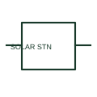

# ANSI/IEEE Solar generating station form

IEEE-library form of solar generating station: a solar generating station is a system-level representation of a documented solar-generation facility.

[Canonical reference](https://eloragrid.ai/symbols/ansi-solar-generating-station) · [Structured record](../entries/ansi-solar-generating-station.json) · [All references](README.md)

Updated: 2026-10-28. Drawing use: SLD, Schematic. Reference families: IEEE / ANSI, Manufacturer.

Graphical convention: IEEE / ANSI. Solar Generating Station, In Service Or Unspecified.

## What it represents

This reference locates solar generating station in Autodesk's IEEE-oriented power stations family. A solar generating station is a system-level representation of a documented solar-generation facility. It identifies the facility type on a system diagram rather than replacing its internal electrical design. The public library uses HDV1\_S00400 for its horizontal representation; this is a vendor block name, not an IEEE standards symbol number.
Use the surrounding circuit labels and the project legend to identify the intended operating condition and connection. Carry the same device reference into the schedule or equipment document so the symbol can be reconciled with its real terminals, function and operating limits.
Use linked SLDs to identify the array, inverter and connection equipment within the station. A station-type marker is a site-level concept, not a single PV module symbol. The linked functional counterpart explains the same operating role in its own drawing context; agreement of every detailed convention mark is not asserted.

## How to read it

- Use linked SLDs to identify the array, inverter and connection equipment within the station.
- The preview is an original explanation of this function. Match the actual drawing convention to its legend and the selected equipment documentation.

## Drawing checklist

- Name facility boundary
- Reference internal SLD
- Identify connection point

## Important distinction

A station-type marker is a site-level concept, not a single PV module symbol.

## Facts

- Convention evidence: Autodesk IEEE Symbol Preview: Power Stations; published form: Solar Generating Station, In Service Or Unspecified.
- Public vendor block: HDV1\_S00400. Vendor library token, not an IEEE symbol number.
- Drawing role: Supply or network role
- Identifier status: The short label is a functional lookup label, not an assigned IEC or IEEE symbol number. Any separately listed Autodesk code is a verified vendor block name.
- Artwork scope: Original educational geometry. Exact standard graphics, product ratings and terminal pinouts are not certified.

## Public references

- [Autodesk IEEE Symbol Preview: Power Stations](https://help.autodesk.com/cloudhelp/2021/ENU/AutoCAD-Electrical/files/GUID-002D3D7C-C3E9-4B60-9F6D-FFBB383C1862.htm) — Autodesk. Public IEEE-oriented Power Stations table explicitly lists HDV1\_S00400 as Solar Generating Station, In Service Or Unspecified. This supports the vendor convention context, not reproduction of the publisher graphic.

## Related references

- [Solar generating station](solar-generating-station.md)
- [Generator](generator.md)
- [Busbar](busbar.md)

Original educational concept geometry, CC BY 4.0. Unitless; not a certified standards glyph or manufacturer footprint.

Elora-authored explanations are CC BY 4.0. Linked standards and manufacturer material retain their own rights. Confirm project requirements using primary sources.
