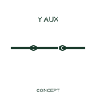

# ANSI/IEEE Solenoid-valve NC auxiliary contact form

IEEE-library form of solenoid-valve nc auxiliary contact: this form identifies a normally-closed auxiliary contact associated with a solenoid valve.

[Canonical reference](https://eloragrid.ai/symbols/ansi-solenoid-valve-nc-auxiliary-contact) · [Structured record](../entries/ansi-solenoid-valve-nc-auxiliary-contact.json) · [All references](README.md)

Updated: 2026-10-28. Drawing use: Schematic. Reference families: IEEE / ANSI, Manufacturer.

Graphical convention: IEEE / ANSI. Solenoid Valve Auxiliary Normally Closed Contact.

## What it represents

This reference locates solenoid-valve nc auxiliary contact in Autodesk's IEEE-oriented solenoids family. This form identifies a normally-closed auxiliary contact associated with a solenoid valve. The public library uses HSV22 for its horizontal representation; this is a vendor block name, not an IEEE standards symbol number.
Read the operating mechanism and the contact reference state together. Cross-reference every associated contact to the same device and show which movement, signal or reset changes its condition; the symbol alone does not establish the complete switching sequence.
State the reference condition used to describe the contact as normally closed. A contact normal state and the process valve normal state are separate descriptions. State the reference condition used to describe the contact as normally closed. A contact normal state and the process valve normal state are separate descriptions. The linked functional counterpart explains the same operating role in its own drawing context; agreement of every detailed convention mark is not asserted.

## How to read it

- State the reference condition used to describe the contact as normally closed.
- A contact normal state and the process valve normal state are separate descriptions.

## Drawing checklist

- Identify the associated device, circuit or diagram boundary.
- State the reference condition used to describe the contact as normally closed.
- Cross-reference the equipment data, terminal mapping or operating-state legend needed to interpret the form.

## Important distinction

A contact normal state and the process valve normal state are separate descriptions.

## Facts

- Convention evidence: Autodesk IEEE Symbol Preview: Solenoids; published form: Solenoid Valve Auxiliary Normally Closed Contact.
- Public vendor block: HSV22. Vendor library token, not an IEEE symbol number.
- Information added: State the reference condition used to describe the contact as normally closed.
- Preview: Independent educational concept; consult the publisher and applicable standard for the exact graphic
- Artwork scope: Original educational geometry. Exact standard graphics, product ratings and terminal pinouts are not certified.

## Public references

- [Autodesk IEEE Symbol Preview: Solenoids](https://help.autodesk.com/cloudhelp/2021/ENU/AutoCAD-Electrical/files/GUID-F7BADF45-D679-4050-BE46-0199A3A76230.htm) — Autodesk. Public IEEE-oriented Solenoids table explicitly lists HSV22 as Solenoid Valve Auxiliary Normally Closed Contact. This supports the vendor convention context, not reproduction of the publisher graphic.

## Related references

- [Solenoid-valve NC auxiliary contact](iec-solenoid-valve-nc-auxiliary-contact.md)
- [Relay coil](relay-coil.md)
- [Normally open contact](normally-open-contact.md)

Original educational concept geometry, CC BY 4.0. Unitless; not a certified standards glyph or manufacturer footprint.

Elora-authored explanations are CC BY 4.0. Linked standards and manufacturer material retain their own rights. Confirm project requirements using primary sources.
