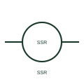

# ANSI/IEEE Solid-state relay form

IEEE-library form of solid-state relay: a solid-state relay switches an output through semiconductor circuitry in response to a control input.

[Canonical reference](https://eloragrid.ai/symbols/ansi-solid-state-relay) · [Structured record](../entries/ansi-solid-state-relay.json) · [All references](README.md)

Updated: 2026-10-28. Drawing use: Schematic. Reference families: IEEE / ANSI, Manufacturer.

Graphical convention: IEEE / ANSI. Solid State.

## What it represents

This reference locates solid-state relay in Autodesk's IEEE-oriented relays and contacts family. A solid-state relay switches an output through semiconductor circuitry in response to a control input. Control isolation, output type and leakage depend on the chosen product. The public library uses HCR1SSD for its horizontal representation; this is a vendor block name, not an IEEE standards symbol number.
Trace the measured quantity or initiating control signal separately from the output contacts. The device tag links the sensing or operating element to the controlled circuit; settings, reset behaviour and the actual terminal arrangement belong in the selected equipment documentation.
Distinguish the low-power input terminals from the load-side output terminals. An SSR has no ordinary mechanical contact gap and must not be treated as a disconnector. The linked functional counterpart explains the same operating role in its own drawing context; agreement of every detailed convention mark is not asserted.

## How to read it

- Distinguish the low-power input terminals from the load-side output terminals.
- The preview is an original explanation of this function. Match the actual drawing convention to its legend and the selected equipment documentation.

## Drawing checklist

- Name output AC or DC type
- State input operating range
- Reference leakage and load limits

## Important distinction

An SSR has no ordinary mechanical contact gap and must not be treated as a disconnector.

## Facts

- Convention evidence: Autodesk IEEE Symbol Preview: Relays and Contacts; published form: Solid State.
- Public vendor block: HCR1SSD. Vendor library token, not an IEEE symbol number.
- Drawing role: Relay operation
- Identifier status: The short label is a functional lookup label, not an assigned IEC or IEEE symbol number. Any separately listed Autodesk code is a verified vendor block name.
- Artwork scope: Original educational geometry. Exact standard graphics, product ratings and terminal pinouts are not certified.

## Public references

- [Autodesk IEEE Symbol Preview — Relays and Contacts](https://help.autodesk.com/cloudhelp/2021/ENU/AutoCAD-Electrical/files/GUID-F8EAC387-53CF-45FE-BE6A-C0C8FB3C1B22.htm) — Autodesk. Public IEEE-oriented Relays and Contacts table explicitly lists HCR1SSD as Solid State. This supports the vendor convention context, not reproduction of the publisher graphic.

## Related references

- [Solid-state relay](solid-state-relay.md)
- [Relay coil](relay-coil.md)
- [Normally open contact](normally-open-contact.md)

Original educational concept geometry, CC BY 4.0. Unitless; not a certified standards glyph or manufacturer footprint.

Elora-authored explanations are CC BY 4.0. Linked standards and manufacturer material retain their own rights. Confirm project requirements using primary sources.
